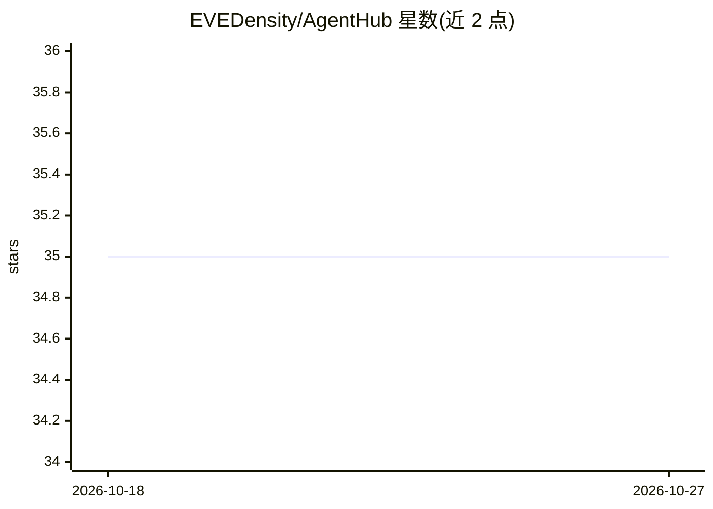

# EVEDensity/AgentHub

⭐ 35 · Python · Apache-2.0 · 推送 2026-10-20 · [GitHub](https://github.com/EVEDensity/AgentHub) · 组织维护

**多 agent 平台的 GitHub CI/发布流程说明文档**

该 README 是 EVEDensity/AgentHub 仓库中关于 GitHub 自动化的工程文档：说明 ci.yml 负责确定性 PR 校验与 CI Gate 状态，涵盖 Python 契约、CLI 检查与 PostgreSQL 迁移检查；发布打包（CLI 标签、桌面标签、安装/升级/回滚探针）与 PR 校验分离。付费 provider 检查、外部恢复证据与模型辅助 PR 评论触发式代码审查为可选集成，非普通 PR 前置条件。桌面 shell 浏览器预览为静态 UI 检查，不验证打包 Next.js 资源、真实登录或 WebView2 行为。README 未给出安装运行指引。

## 筛选速览

| 维度 | 判定 | 备注 |
|---|---|---|
| AI 角色 | `ai-ecosystem` | LLM/agent 周边工具 |
| 许可风险 | `permissive` | Apache-2.0 |
| 部署形态 | `None` |  |
| 模型依赖 | — | README 未给出锁定关系 |
| 硬件要求 | — | 无带数字的原话,不猜 |
| 安装摩擦 | `low` | 无编译、无系统依赖或容器化 |
| 成熟度 | — | 结构信号不足 |

## 能力要点

- ci.yml 统一负责 PR 校验、CLI 检查与 PostgreSQL 迁移检查
- 发布打包（CLI/桌面/探针）与 PR 校验流程分离
- 模型辅助 PR 代码审查通过 PR 评论提及触发，为可选集成

## 适用场景

- 为该仓库贡献者说明 PR 校验与发布流程
- 了解模型辅助代码审查的启用方式与边界

## 场景标签

 · 领域:AI 工程基础设施

## 证据(README 行号)

> L9: Paid provider checks, external recovery evidence and model-assisted PR review

## 星数曲线

2026-10-18 35 → 2026-10-27 35（+0）

---
*卡片 v1 · prompt 1.4 · 生成 2026-10-25 · 置信度 low · 依据 README sha `593ef55a0cb1` · [字段定义](../../DATASET.md)*
