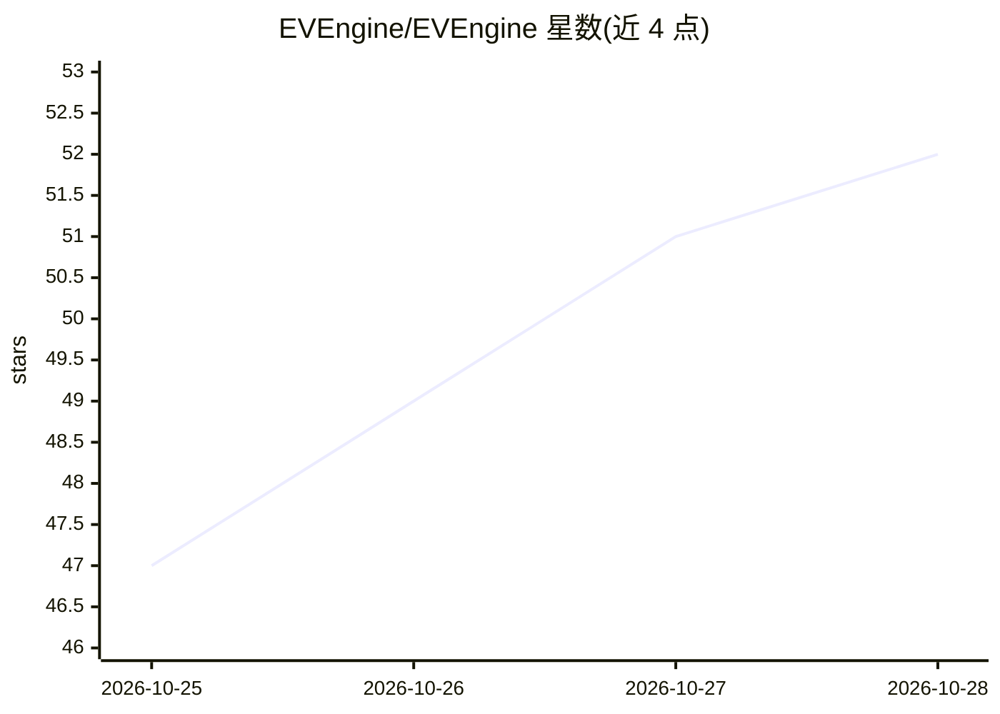

# EVEngine/EVEngine

⭐ 53 · C++ · NOASSERTION · 推送 2026-10-28 · [GitHub](https://github.com/EVEngine/EVEngine) · [官网](https://evengine.github.io/) · 组织维护 · 中文 README

**轻量脚本驱动游戏引擎，支持 AI（MCP）辅助开发与热重载**

面向游戏开发者的解析式游戏引擎，类似 Love2D 方式直接加载脚本（EveScript，兼容 Squirrel）与数据，提供 2D、第三人称 3D 与 2D/3D 混合渲染能力，内置 40+ 模块（Tilemap、Box2D/Box3D 物理、RPG 框架、粒子、流体等）。普通开发者从官网下载预编译 SDK 即可用，无需编译；支持脚本/资源热重载、暂停游戏循环调试、`eve zip` 打包发布及 Android/iOS 组装。调试支持 VS Code 调试适配器与 AI（MCP）辅助开发。引擎开发者可从源码构建（CMake、C++20、Vulkan SDK ≥ 1.2）。运行时需要 Vulkan 驱动；采用双许可，商用营收超免费门槛需商业授权。

## 筛选速览

| 维度 | 判定 | 备注 |
|---|---|---|
| AI 角色 | `ai-enhanced` | 去掉 AI 部分产品仍成立 |
| 许可风险 | `none` | NOASSERTION |
| 部署形态 | `desktop` | 安装包/桌面程序 |
| 模型依赖 | — | README 未给出锁定关系 |
| 硬件要求 | — | 无带数字的原话,不猜 |
| 安装摩擦 | `low` | 无编译、无系统依赖或容器化 |
| 成熟度 | — | 结构信号不足 |

## 能力要点

- 预编译 SDK 下载即用，无需编译引擎与 Vulkan SDK
- 脚本/资源热重载，移动端经 `eve dev` 开发服务器推送到真机
- 40+ 模块经 EveScript（兼容 Squirrel）调用，支持 C++ 原生插件
- 调试支持断点/快照/VS Code 调试适配器与 AI（MCP）辅助开发

## 适用场景

- 用脚本快速制作 2D / 第三人称 3D / 2D+3D 混合游戏原型
- 改脚本实时热重载观察效果，快速迭代调试
- 把游戏打包为 .eve 归档或组装 Android/iOS 安装包分发

## 场景标签

 · 领域:游戏开发/引擎

## 证据(README 行号)

> L99: - **调试**：暂停游戏循环、断点、监视、快照，支持 VS Code 调试适配器与 AI（MCP）辅助开发。
> L18: 针对很多游戏引擎开发效率低、难以调试、难以动态快速实现游戏原型的问题，我们设计了一款非常简单好用的游戏引擎。它主要提供 2D、第三人称 3D 与 2D/3D 混合的游戏组件能力，不提供复杂 3D 引擎中的场景管理等重量级功能。

## 星数曲线

2026-10-25 47 → 2026-10-28 52（+5）

---
*卡片 v1 · prompt 1.4 · 生成 2026-10-25 · 置信度 mid · 依据 README sha `fa5f3072a12b` · [字段定义](../../DATASET.md)*
