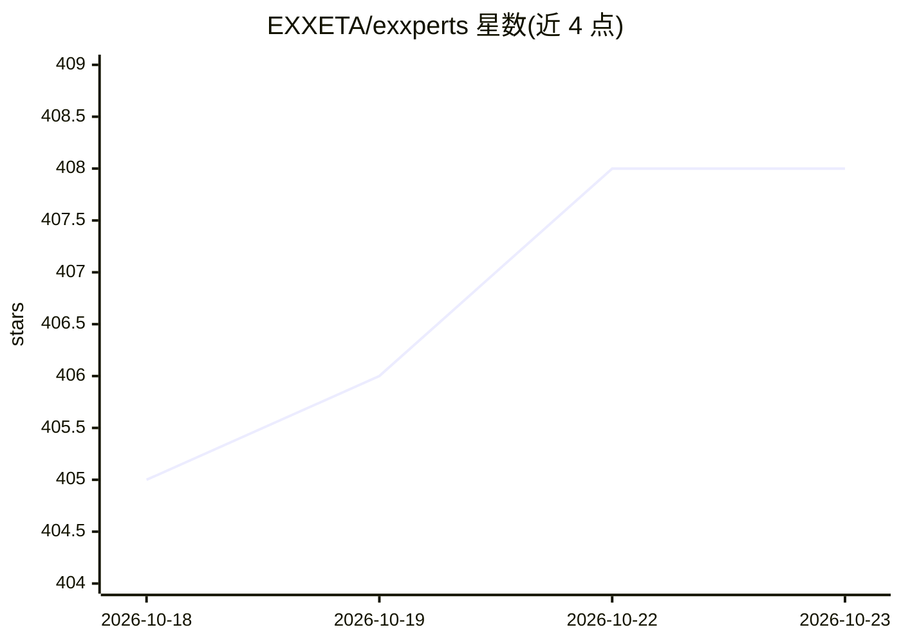

# EXXETA/exxperts

⭐ 408 · TypeScript · Apache-2.0 · 推送 2026-10-19 · [GitHub](https://github.com/EXXETA/exxperts) · 组织维护

**本地优先的 AI 同事应用：审批制记忆，任意模型商**

桌面/浏览器/终端多形态的本地优先 AI agent 应用：以"房间"为单位组织工作，agent 可搜索网页、读写文档、执行后台任务；对话结束时提出记忆提案，用户审批后方可写入，每条笔记带溯源与历史时间线。支持 Claude、ChatGPT、Gemini、Mistral 及任意 OpenAI 兼容端点（含本地模型），可随时切换而不丢记忆。所有数据以明文文件存于本机，默认无云端、无遥测；提供桌面安装包与一行脚本安装，需自备 AI 订阅或 API key。

## 筛选速览

| 维度 | 判定 | 备注 |
|---|---|---|
| AI 角色 | `ai-native` | 本体是模型或模型工具 |
| 许可风险 | `permissive` | Apache-2.0 |
| 部署形态 | `desktop` | 安装包/桌面程序 |
| 模型依赖 | locked-api |  |
| 硬件要求 | — | 无带数字的原话,不猜 |
| 安装摩擦 | `low` | 无编译、无系统依赖或容器化 |
| 成熟度 | — | 结构信号不足 |

## 能力要点

- 记忆写入需经审批门，每条笔记带来源对话与时间线
- 多模型商支持（Claude/ChatGPT/Gemini/Mistral/OpenAI 兼容端点，含本地模型）
- 内置 MCP 连接器、后台任务与 DuckDuckGo/SearXNG 网页搜索
- 桌面应用三平台签名分发，亦有 CLI 与浏览器形态

## 适用场景

- 让 AI 同事在长期记忆中积累我的工作上下文
- 本地保存对话、凭据与产出文件，不依赖云账户
- 在多个 AI 供应商之间切换而保留已积累的记忆

## 场景标签

`AI 助手` `Agent 记忆` · 领域:Agent 开发

## 证据(README 行号)

> L3:  AI colleagues that learn and remember. On your machine, under your control.
> L46: **Work.** A room replaces a chat thread: it is the durable place where you set up your exxpert's tools, folders, co
> L61: - **No provider lock-in.** Claude, ChatGPT, Gemini, Mistral, or any OpenAI-compatible endpoint, including local mod

## 星数曲线

2026-10-18 405 → 2026-10-23 408（+3）

---
*卡片 v1 · prompt 1.4 · 生成 2026-10-21 · 置信度 mid · 依据 README sha `81269183ec29` · [字段定义](../../DATASET.md)*
