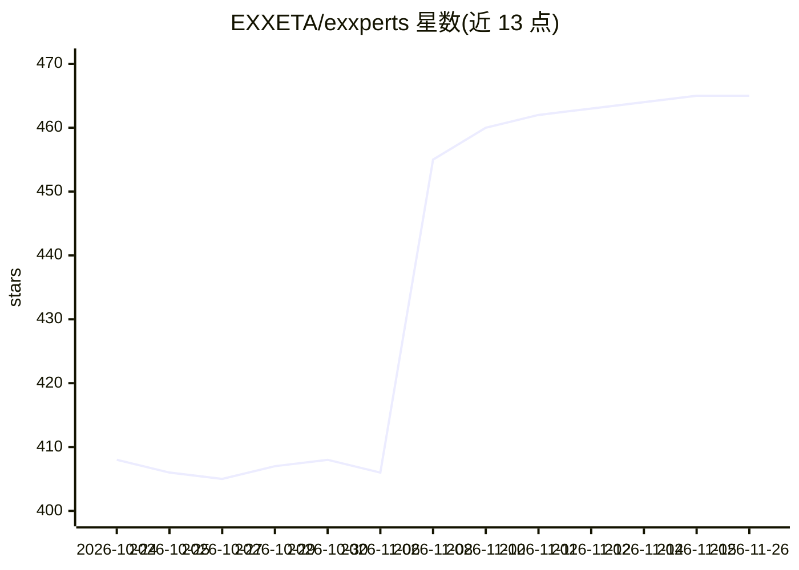

# EXXETA/exxperts

⭐ 465 · TypeScript · Apache-2.0 · 推送 2026-11-25 · [GitHub](https://github.com/EXXETA/exxperts) · [官网](https://exxperts.ai) · 组织维护

**先审阅再记忆的 AI 桌面应用：保存前让你核对记忆草稿**

基于 Electron 的开源桌面应用，以「房间」为单位按项目/主题组织 AI 对话。核心机制是人工确认的记忆流程：每次对话结束后由房间起草记忆条目，用户编辑、保存或丢弃；记忆以 Markdown 文件存在本地 ~/.exxperts 目录，下一次对话读取这些笔记。支持记忆整理、历史回溯、撤销与手动编辑，提供网页搜索、文件夹内文件操作、图表绘制、MCP 连接器、技能导入与定时任务。应用本身免费无账号，用户自带 AI 订阅或 API key。

## 筛选速览

| 维度 | 判定 | 备注 |
|---|---|---|
| AI 角色 | `ai-native` | 本体是模型或模型工具 |
| 许可风险 | `permissive` | Apache-2.0 |
| 部署形态 | `None` |  |
| 模型依赖 | local-ok | 支持本地模型 |
| 硬件要求 | — | 无带数字的原话,不猜 |
| 安装摩擦 | `low` | 无编译、无系统依赖或容器化 |
| 成熟度 | — | 结构信号不足 |

## 能力要点

- Remember 按钮生成记忆草稿，用户确认后才保存（human-in-the-loop）
- 记忆为本地 Markdown 文件，附历史记录、回溯图表与撤销
- 支持订阅登录（ChatGPT/Claude/Copilot）、API key 与 OpenAI 兼容网关三种接入方式
- 每个房间独立记忆、指令与模型，可 @ 引用其他房间记忆

## 适用场景

- 按项目分房间管理长期 AI 对话并控制记忆内容
- 处理保密工作，数据只发给自己选定的 AI 提供商
- 控制 token 消耗，用记忆替代读取完整聊天历史

## 场景标签

`Agent 记忆` `AI 助手` `知识库管理` · 领域:Agent 开发

## 证据(README 行号)

> L3:  A free, open-source desktop app for getting work done with AI
> L35: 1. **Work in a room.** Ask, write and research as you would in any AI chat.
> L71: A room's memory lives in one file, `~/.exxperts/app/personalized-agents/<room>/L1b/current.md`, and any editor can 

## 星数曲线

2026-10-24 408 → 2026-11-26 465（+57）

---
*卡片 v1 · prompt 1.4 · 生成 2026-11-25 · 置信度 high · 依据 README sha `48419f8d044b` · [字段定义](../../DATASET.md)*
