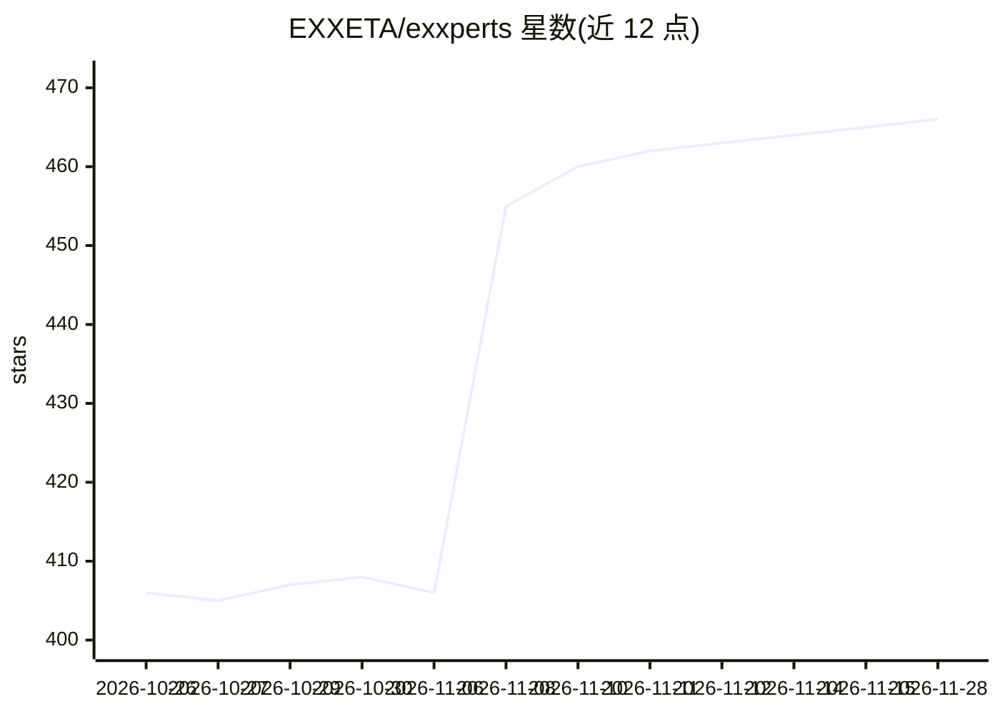

# EXXETA/exxperts

⭐ 466 · TypeScript · Apache-2.0 · 推送 2026-11-26 · [GitHub](https://github.com/EXXETA/exxperts) · [官网](https://exxperts.ai) · 组织维护

**记忆可见可控的桌面 AI 工作台：保存前先审阅**

Exxeta 开发的 Electron 桌面应用，围绕"房间"组织 AI 对话：每个房间绑定一个项目或主题，拥有独立的指令、记忆文件、文件夹与模型选择。核心机制是 human-in-the-loop 记忆——按下 Remember 后房间起草要保留的笔记，用户编辑或丢弃后才写入本地 Markdown 文件；支持按主题整理笔记、历史回溯、撤销、手动编辑与 AI 整理。数据全部存于本机 ~/.exxperts，无自有账号与服务器。提供 Mac/Windows/Linux 安装包。

## 筛选速览

| 维度 | 判定 | 备注 |
|---|---|---|
| AI 角色 | `ai-native` | 本体是模型或模型工具 |
| 许可风险 | `permissive` | Apache-2.0 |
| 部署形态 | `None` |  |
| 模型依赖 | locked-api |  |
| 硬件要求 | — | 无带数字的原话,不猜 |
| 安装摩擦 | `low` | 无编译、无系统依赖或容器化 |
| 成熟度 | — | 结构信号不足 |

## 能力要点

- 保存前展示记忆草稿，用户编辑确认后才写入
- 记忆为本地 Markdown 文件（~/.exxperts），任意编辑器可打开
- 支持 ChatGPT/Claude/GitHub Copilot 登录、API key 或 OpenAI 兼容网关接入
- 连接 GitHub/Notion/Linear 等 connector 与任意 MCP 服务器，可导入 skills

## 适用场景

- 按项目/论文/客户访谈分房间管理长期 AI 协作
- 涉密工作中控制记忆内容与数据流向
- 定时任务与跨房间提问汇总记忆

## 场景标签

`Agent 记忆` `AI 助手` · 领域:Agent 开发

## 证据(README 行号)

> L3:  A free, open-source desktop app for getting work done with AI
> L29: In exxperts you see it before it is kept. When you press **Remember**, the draft says "Adopting the new reporting t
> L113: **Stored on your computer:** your rooms, their memory and conversations, the files they make, and your sign-ins, i

## 星数曲线

2026-10-26 406 → 2026-11-28 466（+60）

---
*卡片 v1 · prompt 1.4 · 生成 2026-11-26 · 置信度 high · 依据 README sha `fb9d9f020bcc` · [字段定义](../../DATASET.md)*
