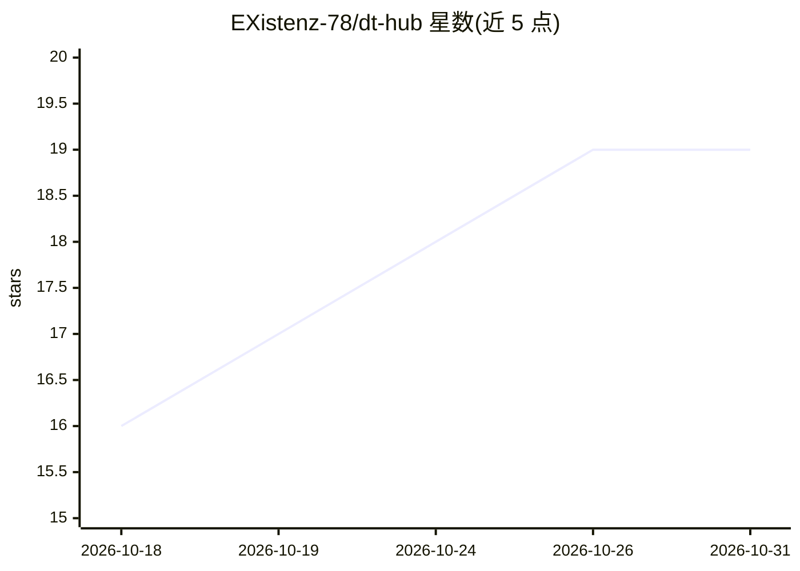

# EXistenz-78/dt-hub

⭐ 19 · Swift · GPL-3.0 · 推送 2026-10-30 · [GitHub](https://github.com/EXistenz-78/dt-hub) · 个人维护

**macOS 图像生成工作台：连接 Draw Things 服务器准备与启动生成**

面向 Draw Things 用户的原生 macOS 伴侣应用：自身不做渲染，而是通过 gRPC 连接 Draw Things 服务器，围绕生成过程提供常驻可见的起始图/Moodboard/画布、可经 Sidecar 在 iPad 上作画的画布窗口、生成队列、预设管线、项目管理、LoRA 触发词管理，以及 20 个带独立标签页的插件。内置可本地运行的 MLX LLM 用于改写与生成提示词（推荐 Qwen3-VL-8B 4bit，约 5.8GB，需手动确认下载）。要求 macOS 26 与 Apple Silicon，可自启动或连接 Draw Things 的 gRPCServerCLI。

## 筛选速览

| 维度 | 判定 | 备注 |
|---|---|---|
| AI 角色 | `ai-ecosystem` | LLM/agent 周边工具 |
| 许可风险 | `viral` | GPL-3.0 |
| 部署形态 | `desktop` | 安装包/桌面程序 |
| 模型依赖 | — | README 未给出锁定关系 |
| 硬件要求 | — | 无带数字的原话,不猜 |
| 安装摩擦 | `medium` | 含编译或系统依赖之一 |
| 成熟度 | — | 结构信号不足 |

## 能力要点

- 通过 gRPC 连接 Draw Things 服务器，管理图像生成全流程
- 画布窗口可经 Sidecar 移至 iPad 用 Apple Pencil 绘制蒙版
- 内置 MLX 本地 LLM，支持 Enhance/Generate Prompt 与图像理解
- 20 个插件：Prompt Master 系列、Tiled Upscale、Panorama 360 等，各带独立标签页

## 适用场景

- 在 Mac 上为 Draw Things 准备提示词、参考图与参数后一键发起生成
- 用 iPad 当画板绘制重绘蒙版或直接在图上作画
- 把多个预设串成管线批量排队生成，按项目组织产出
- 用本地 LLM 改写提示词或让其代写生成配置

## 场景标签

`图像生成` `提示工程` · 领域:Agent 开发

## 证据(README 行号)

> L3: A native macOS companion for Draw Things: a dedicated workspace for **preparing and launching image generations**. D
> L58: - A Draw Things gRPC server: the Draw Things app with its API server enabled, or the `gRPCServerCLI` binary, which 

## 星数曲线

2026-10-18 16 → 2026-10-31 19（+3）

---
*卡片 v1 · prompt 1.4 · 生成 2026-10-29 · 置信度 high · 依据 README sha `af4eef2e2455` · [字段定义](../../DATASET.md)*
