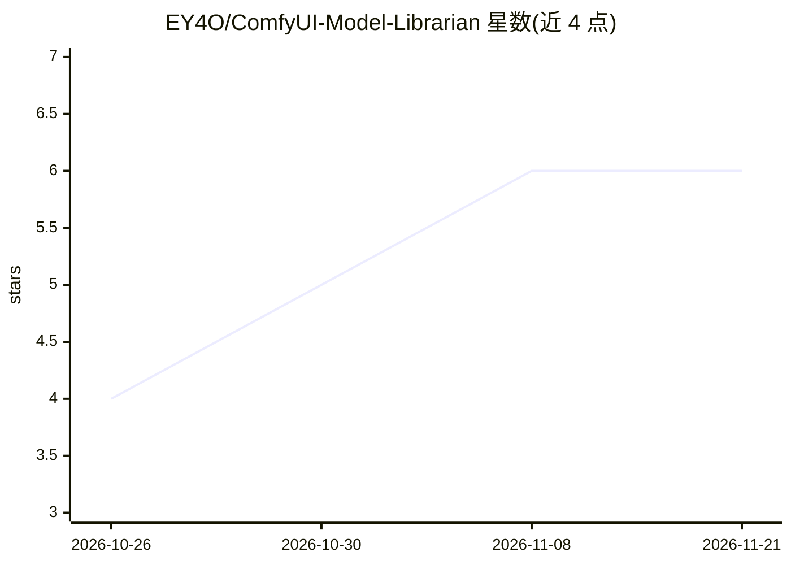

# EY4O/ComfyUI-Model-Librarian

⭐ 6 · Python · MIT · 推送 2026-11-02 · [GitHub](https://github.com/EY4O/ComfyUI-Model-Librarian) · [官网](https://librarian.eternalpose.io/) · 个人维护

**ComfyUI 模型管理器：共享文件夹中查找、下载与归类模型**

围绕共享模型文件夹（Stability Matrix 或 Comfy Desktop）构建的 ComfyUI 自定义节点，与 LoRA Manager 协同。提供缺失模型查找下载（SHA256 校验、断点续传）、按基础模型自动归类、从图片提取配方、重复文件检测、CivitAI 元数据同步与更新提醒、SSD/HDD 存储分层等功能。通过 ComfyUI-Manager、comfy CLI 或 git clone 安装，无额外 Python 依赖；CivitAI 下载需 API key，受限 HuggingFace 模型需 token。

## 筛选速览

| 维度 | 判定 | 备注 |
|---|---|---|
| AI 角色 | `ai-ecosystem` | LLM/agent 周边工具 |
| 许可风险 | `permissive` | MIT |
| 部署形态 | `None` |  |
| 模型依赖 | — | README 未给出锁定关系 |
| 硬件要求 | — | 无带数字的原话,不猜 |
| 安装摩擦 | `low` | 无编译、无系统依赖或容器化 |
| 成熟度 | — | 结构信号不足 |

## 能力要点

- 扫描工作流并按信任顺序查找缺失模型来源，SHA256 校验下载
- 按基础模型（Illustrious/Pony/Flux 等）自动归类，含 tensor 布局证据
- 从图片/视频提取 prompt、checkpoint 与 LoRA 配方，支持多工具格式
- SSD/HDD 存储分层与重复文件检测（硬链接替换）

## 适用场景

- 管理大量 Stable Diffusion 类模型，按基础模型整理文件夹
- 下载工作流所缺模型并校验完整性
- 在 SSD 空间不足时将不常用模型归档到硬盘
- 与他人分享带模型下载链接的工作流

## 场景标签

 · 领域:AI 图像生成工具链/模型管理

## 证据(README 行号)

> L13: A model manager for ComfyUI built around a **shared models folder** — Stability Matrix's, or the one Comfy Desktop 
> L21: - 🔍 **Missing-model finder** — scans the open workflow (subgraphs, rgthree and LoRA Manager nodes included) and fin

## 星数曲线

2026-10-26 4 → 2026-11-21 6（+2）

---
*卡片 v1 · prompt 1.4 · 生成 2026-11-20 · 置信度 high · 依据 README sha `b1a501e9f403` · [字段定义](../../DATASET.md)*
