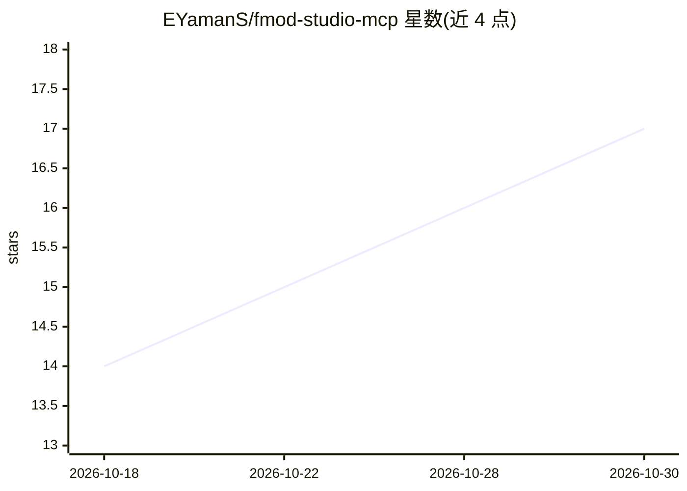

# EYamanS/fmod-studio-mcp

⭐ 17 · Python · MIT · 推送 2026-10-12 · [GitHub](https://github.com/EYamanS/fmod-studio-mcp) · [官网](https://pypi.org/project/fmod-studio-mcp/) · 个人维护

**供 AI agent 实时操控 FMOD Studio 音频制作的 MCP 服务器**

通过 FMOD Studio 内置脚本终端（TCP 3663）驱动正在运行的编辑器的 MCP 服务器，面向 AI agent（Claude Code）编写游戏音频。将 Scripting API 的约 148 个成员生成一一对应的 MCP 工具，并提供读写属性、编辑关系、类内省等通用工具；无任意脚本执行工具，均为命名且经 schema 校验的操作。要求 FMOD Studio 2.02+、开启 Script Server 并重启、Python 3.10+；直接编辑活动项目，需调用保存工具持久化。自述处于 Alpha 阶段。

## 筛选速览

| 维度 | 判定 | 备注 |
|---|---|---|
| AI 角色 | `ai-ecosystem` | LLM/agent 周边工具 |
| 许可风险 | `permissive` | MIT |
| 部署形态 | `library` | 以包/库形式分发 |
| 模型依赖 | — | README 未给出锁定关系 |
| 硬件要求 | — | 无带数字的原话,不猜 |
| 安装摩擦 | `low` | 无编译、无系统依赖或容器化 |
| 成熟度 | `idea` | |

## 能力要点

- FMOD Scripting API 成员生成约 148 个命名 MCP 工具，另有通用属性/关系操作工具
- 通过 TCP 脚本终端直接作用于运行中的 FMOD Studio，改动即时生效且由 Studio 自行写入
- 无任意脚本/eval 工具，所有能力为 schema 校验的命名操作
- 工具集由爬取官方 API 参考自动生成，新版本可重跑爬虫再生成

## 适用场景

- 让 Claude 等 MCP 客户端直接在 FMOD Studio 中创建事件、导入音频、分配 bank
- AI agent 按步骤或用组合工具一次性搭建游戏音频结构
- 对运行中的 FMOD 项目做自动化编辑而无需重启 Studio

## 场景标签

 · 领域:游戏音频/开发工具

## 证据(README 行号)

> L6: An MCP server that drives **FMOD Studio live**
> L18: > ⚠️ **Alpha.** Built for an AI agent (Claude Code) to author game audio. It edits the

## 星数曲线

2026-10-18 14 → 2026-10-30 17（+3）

---
*卡片 v1 · prompt 1.4 · 生成 2026-10-30 · 置信度 high · 依据 README sha `286dc3ba787f` · [字段定义](../../DATASET.md)*
