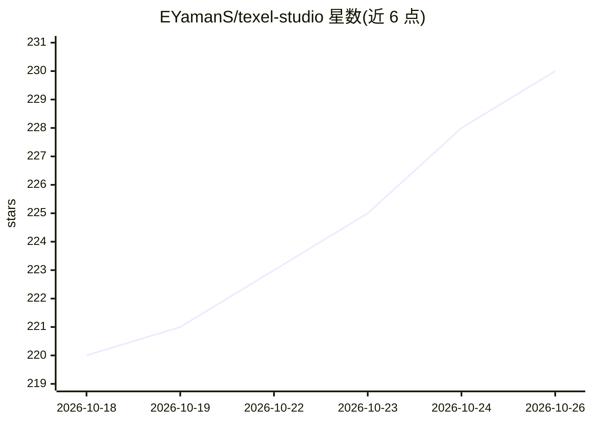

# EYamanS/texel-studio

⭐ 230 · Python · NOASSERTION · 推送 2026-10-12 · [GitHub](https://github.com/EYamanS/texel-studio) · [官网](https://texel.studio) · 个人维护

**AI agent 逐像素绘制像素画/游戏素材的工具**

面向游戏开发者与像素画创作者的开源引擎：AI agent 通过调用绘图工具（画点、矩形、线、圆、Voronoi 填充、噪点填充等）在画布上逐像素作画，先由 AI 生成参考概念图，再经对话持续修改，可生成图块/道具图标并导出 16 变体 autotile 图集。支持 Gemini、OpenAI 与本地 Ollama 模型，本地运行无需 API key；可选 Redis 队列、S3 存储与 LangSmith/PostHog 追踪。源码可见许可，禁止作为竞争 SaaS 托管。

## 筛选速览

| 维度 | 判定 | 备注 |
|---|---|---|
| AI 角色 | `ai-native` | 本体是模型或模型工具 |
| 许可风险 | `none` | NOASSERTION |
| 部署形态 | `None` |  |
| 模型依赖 | local-ok | 支持本地模型 |
| 硬件要求 | — | 无带数字的原话,不猜 |
| 安装摩擦 | `low` | 无编译、无系统依赖或容器化 |
| 成熟度 | — | 结构信号不足 |

## 能力要点

- agent 以工具调用方式逐像素作画，非扩散模型生成
- 生成 16 变体 autotile 图集，导出原生 PNG/512px 放大
- 多模型接入：Gemini/OpenAI/本地 Ollama，本地运行零成本
- 对话式继续编辑同一 agent 会话，进度 SSE 实时流式展示

## 适用场景

- 为游戏生成可平铺的图块与道具图标素材
- 通过对话让 agent 逐步修改像素画细节
- 使用本地模型免费生成调色板受限的像素素材

## 场景标签

`图像生成` · 领域:内容生成

## 证据(README 行号)

> L9: Texel Studio is different. An AI agent picks up a brush, places pixels on a canvas one at a time, steps back to look
> L20: 4. **Watch the agent paint** — it uses drawing tools to build the sprite step by step
> L22: 6. **Export** — native size PNG, upscaled 512px, or full autotile tileset (16 variants)

## 星数曲线

2026-10-18 220 → 2026-10-26 230（+10）

---
*卡片 v1 · prompt 1.4 · 生成 2026-10-22 · 置信度 high · 依据 README sha `3165904667e9` · [字段定义](../../DATASET.md)*
