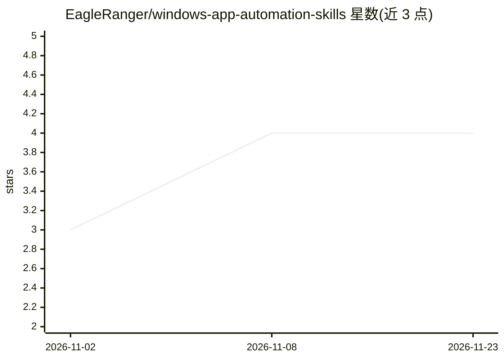

# EagleRanger/windows-app-automation-skills

⭐ 4 · 推送 2026-11-02 · [GitHub](https://github.com/EagleRanger/windows-app-automation-skills) · 个人维护 · 中文 README

**面向 AI Agent 的 Windows 办公软件自动化 Skill 合集**

集中分发的 Windows 办公软件自动化 Skill 合集，v1.1.1 含 13 个可独立安装的 Skill，覆盖 CAD/天正图纸校审标注、ArcGIS Pro 与奥维地图 GIS 自动化、WPS 控制排版、Photoshop 图层生产、Chrome 受管浏览器、网页生图、PPT Master 景观文本增强版、图册报告范本复刻及 Obsidian 配置。通过 PowerShell 安装器复制 Skill，各工具按独立目录与依赖运行；新机器需自行配置正版软件、Python 环境等。CAD 批量标注 Skill 附带执行源码。

## 筛选速览

| 维度 | 判定 | 备注 |
|---|---|---|
| AI 角色 | `ai-knowledge` | 知识聚合/清单类 |
| 许可风险 | `none` | — |
| 部署形态 | `None` |  |
| 模型依赖 | — | README 未给出锁定关系 |
| 硬件要求 | — | 无带数字的原话,不猜 |
| 安装摩擦 | `low` | 无编译、无系统依赖或容器化 |
| 成熟度 | — | 结构信号不足 |

## 能力要点

- 13 个可独立安装的 Skill，按需选择安装
- 覆盖 CAD/天正、GIS、WPS、Photoshop、浏览器等 Windows 软件
- CAD 批量标注 Skill 随包提供公式、规划器与执行源码
- 包内附各 Skill 指纹与 SHA-256，提供 catalog.json 机器可读清单

## 适用场景

- 让 AI Agent 自动控制 CAD/天正做图纸校审与批量标注
- 用 Skill 驱动 WPS 做报告排版与图册生成
- 通过 Photoshop Skill 自动化图层生产
- 用 Obsidian Skill 配置本地知识库

## 场景标签

`GUI 自动化` `浏览器自动化` `知识库管理` · 领域:效率与自动化

## 证据(README 行号)

> L1: # Windows 办公软件自动化 Skill 合集与项目索引
> L3: 集中下载办公软件控制、图册/报告、景观 PPT 和 Obsidian 配置。当前 **v1.1.1** 包含 **13 个可安装的独立 Skill**，并保留 1 个 Obsidian 安装附件。各工具继续按独立目录和自己的依赖运行
> L45: 如果实际下载、使用或借鉴后觉得对开发有帮助，欢迎自愿给对应项目 Star。EagleRanger 提出需求与验收，OpenAI Codex 协助整理、打包和核验。

## 星数曲线

2026-11-02 3 → 2026-11-23 4（+1）

---
*卡片 v1 · prompt 1.4 · 生成 2026-11-21 · 置信度 high · 依据 README sha `e59448b79f9d` · [字段定义](../../DATASET.md)*
