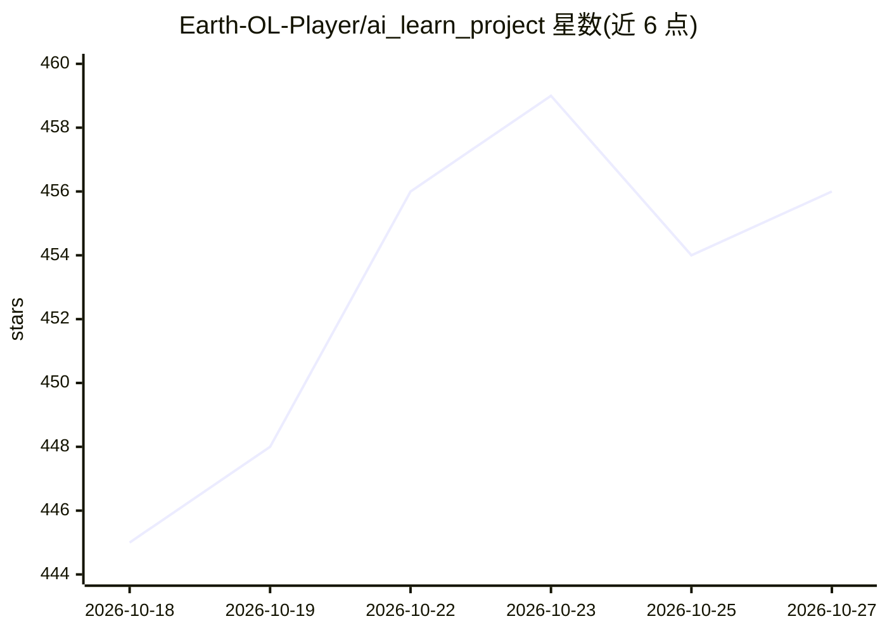

# Earth-OL-Player/ai_learn_project

⭐ 456 · Java · NOASSERTION · 推送 2026-10-22 · [GitHub](https://github.com/Earth-OL-Player/ai_learn_project) · [官网](https://ai-studyhub.cn) · 个人维护 · 中文 README

**面向 AI 应用开发者的一站式 Agent 开发学习与刷题平台**

全栈学习平台，把 Agent/AI 应用开发学习路线、面试题库、AI 智能刷题、成长体系和建议社区整合在同一项目中。技术栈为 Vue 3 + TypeScript 前端、Spring Boot 业务后端、FastAPI AI 服务（本地规则兜底或外部模型服务）、MySQL 数据库。刷题功能包含 AI 评分、追问讨论、历史最高分与薄弱题分析，题库覆盖 Agent 基础、RAG、向量检索、多智能体等方向。提供在线站点与本地部署文档，面向学习 AI Agent 与大模型工程化的开发者。

## 筛选速览

| 维度 | 判定 | 备注 |
|---|---|---|
| AI 角色 | `ai-native` | 本体是模型或模型工具 |
| 许可风险 | `none` | NOASSERTION |
| 部署形态 | `None` |  |
| 模型依赖 | — | README 未给出锁定关系 |
| 硬件要求 | — | 无带数字的原话,不猜 |
| 安装摩擦 | `medium` | 含编译或系统依赖之一 |
| 成熟度 | — | 结构信号不足 |

## 能力要点

- AI 智能刷题：评分、追问讨论、薄弱题分析
- 面试题库覆盖 Agent/RAG/多智能体等方向
- Vue 3 + Spring Boot + FastAPI + MySQL 全栈闭环
- 经验、等级、段位、勋章的成长体系

## 适用场景

- 系统学习 AI Agent、RAG 与大模型工程化开发
- 准备 AI 方向技术面试并刷高频题
- 参考全栈项目结构做二次开发学习

## 场景标签

`教程课程` · 领域:学习与行业

## 证据(README 行号)

> L3: > 面向 AI 应用开发者的一站式学习平台：把学习路线、面试题库、AI 智能刷题、成长体系和建议社区放在同一个可运行的全栈项目里。
> L25: |AI 智能刷题|支持题目分类、下一题、重答、AI 评分、AI 追问讨论和历史最高分展示。|

## 星数曲线

2026-10-18 445 → 2026-10-27 456（+11）

---
*卡片 v1 · prompt 1.4 · 生成 2026-10-21 · 置信度 high · 依据 README sha `64ae73a68643` · [字段定义](../../DATASET.md)*
