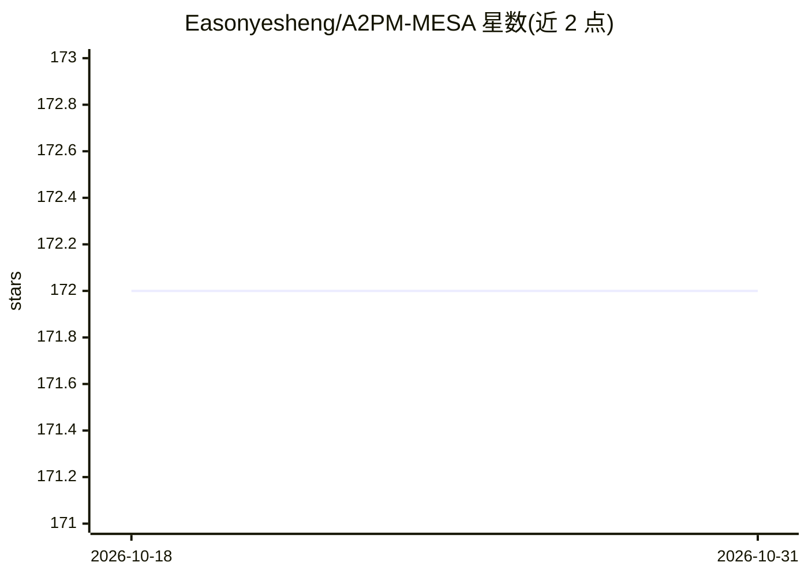

# Easonyesheng/A2PM-MESA

⭐ 172 · Python · MIT · 推送 2026-05-28 · [GitHub](https://github.com/Easonyesheng/A2PM-MESA) · 个人维护 · 中文 README

**面向图像特征匹配的 Area to Point Matching 框架实现**

Area to Point Matching（A2PM）框架的用户友好实现，包含 SGAM（PR'26）、training-free 版 MESA（CVPR'24）与 DMESA（TPAMI'26）三种方法。核心机制为：先做语义区域匹配（SAM/SAM2 分割预处理）降低匹配冗余，再在区域内做点匹配（SuperGlue/LoFTR/DKM/MASt3R/DUSt3R 等），最后由几何区域匹配模块融合。基于 hydra 配置系统，各组件可通过 yaml 替换扩展。以源码形式提供，需 git clone --recursive、conda 环境、下载预训练权重；MASt3R 需单独环境。面向计算机视觉研究者与 SLAM/SfM 开发者，提供 ScanNet1500 与 MegaDepth1500 基准评测代码。

## 筛选速览

| 维度 | 判定 | 备注 |
|---|---|---|
| AI 角色 | `ai-native` | 本体是模型或模型工具 |
| 许可风险 | `permissive` | MIT |
| 部署形态 | `library` | 以包/库形式分发 |
| 模型依赖 | — | README 未给出锁定关系 |
| 硬件要求 | — | 无带数字的原话,不猜 |
| 安装摩擦 | `medium` | 含编译或系统依赖之一 |
| 成熟度 | — | 结构信号不足 |

## 能力要点

- 区域匹配+点匹配+几何融合的三段式 A2PM 流程
- 支持 SAM/SAM2 分割预处理与多种点匹配器（SuperGlue/LoFTR/ELoFTR/DKM/MASt3R/DUSt3R）
- 基于 hydra 的可配置组件体系，可自行新增匹配器与数据集
- 提供 demo 脚本与 Pose AUC、匹配精度等评测代码

## 适用场景

- 在大分辨率、大尺度/视角变化图像对之间做特征匹配
- 为 SLAM/SfM 任务提供区域到点的匹配方案
- 在 ScanNet1500/MegaDepth1500 上复现或对比 MESA 系列方法

## 场景标签

`图像视频处理` · 领域:感知与多模态

## 证据(README 行号)

> L8: This is a user-friendly implementation of **Area to Point Matching** (A2PM) framework, powered by hydra.
> L10: It contains the implementation of SGAM (PR'26, early-version-code), a training-free version of MESA (CVPR'24, proje
> L148: >Area matching is to establish semantic area matches between two images for matching reduandancy reduction, which 

## 星数曲线

2026-10-18 172 → 2026-10-31 172（+0）

---
*卡片 v1 · prompt 1.4 · 生成 2026-10-22 · 置信度 high · 依据 README sha `06fc731b193b` · [字段定义](../../DATASET.md)*
