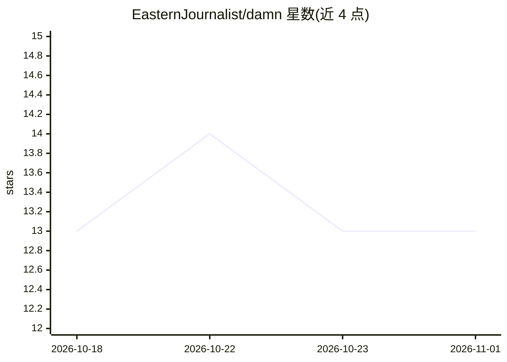

# EasternJournalist/damn

⭐ 13 · Python · 推送 2025-12-22 · [GitHub](https://github.com/EasternJournalist/damn) · 个人维护 · 中文 README

**把自然语言指令转换为 Linux 命令的 shell 工具**

Linux shell 工具，按 Alt+D 快捷键将随意描述的指令交给 AI 模型生成对应的 bash 命令。无系统依赖，通过 install.sh 脚本安装；运行需自备一个 LLM API key，支持 OpenAI GPT、Google Gemini 与字节跳动豆包三种 API 服务（README 提及 Gemini 与豆包提供免费额度）。定位为 thefuck 和 shell_gpt 的同类替代，主打最小化使用成本。

## 筛选速览

| 维度 | 判定 | 备注 |
|---|---|---|
| AI 角色 | `ai-native` | 本体是模型或模型工具 |
| 许可风险 | `none` | — |
| 部署形态 | `None` |  |
| 模型依赖 | — | README 未给出锁定关系 |
| 硬件要求 | — | 无带数字的原话,不猜 |
| 安装摩擦 | `low` | 无编译、无系统依赖或容器化 |
| 成熟度 | — | 结构信号不足 |

## 能力要点

- Alt+D 一键从自然语言生成命令
- 支持 OpenAI GPT / Google Gemini / 字节豆包三种 API
- install.sh 一键安装，无系统依赖

## 适用场景

- 不熟悉 bash 语法的用户快速得到想要的命令
- 日常终端操作中用一句话描述代替查命令

## 场景标签

`代码生成` · 领域:编码与开发

## 证据(README 行号)

> L13: Get the Linux command from a casual instruction.
> L33: You will need an API key to use the AI models.

## 星数曲线

2026-10-18 13 → 2026-11-01 13（+0）

---
*卡片 v1 · prompt 1.4 · 生成 2026-10-31 · 置信度 high · 依据 README sha `c197c76463d1` · [字段定义](../../DATASET.md)*
