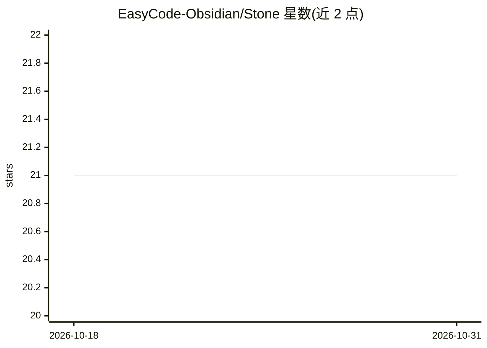

# EasyCode-Obsidian/Stone

⭐ 21 · TypeScript · Apache-2.0 · 推送 2026-08-29 · [GitHub](https://github.com/EasyCode-Obsidian/Stone) · [官网](https://github.com/EasyCode-Obsidian/Stone/releases/latest) · 组织维护 · 中文 README

**本地优先的桌面 AI 网关：把编码客户端接入多供应商账号池**

面向个人用户的 Windows/macOS/Linux 桌面应用，在本地运行 AI 网关，将 Claude Code、Codex、Gemini CLI 等编码客户端接入 OpenAI、Anthropic、Gemini 及兼容端点。核心机制包括账号池调度（优先级/轮询/加权等，含重试、冷却、故障转移）、OpenAI/Anthropic/Gemini 协议互转、按账号的模型暴露控制、Codex 配额可视化，以及客户端配置文件的备份与还原。凭据存于操作系统安全存储，请求/响应体不入库。当前界面为简体中文，构建未签名且 macOS 未公证。

## 筛选速览

| 维度 | 判定 | 备注 |
|---|---|---|
| AI 角色 | `ai-ecosystem` | LLM/agent 周边工具 |
| 许可风险 | `permissive` | Apache-2.0 |
| 部署形态 | `desktop` | 安装包/桌面程序 |
| 模型依赖 | locked-api |  |
| 硬件要求 | — | 无带数字的原话,不猜 |
| 安装摩擦 | `low` | 无编译、无系统依赖或容器化 |
| 成熟度 | — | 结构信号不足 |

## 能力要点

- 账号池调度：优先级/均衡/轮询/加权随机，含重试、冷却与故障转移
- OpenAI Responses / Chat Completions、Anthropic Messages、Gemini generateContent 协议互转（含流式与工具调用）
- 管理 Claude Code、Codex、Gemini CLI 配置文件，改动前备份可还原
- 凭据存于系统安全存储，网关仅接受本机连接

## 适用场景

- 把 Claude Code、Codex、Gemini CLI 统一接入一个本地网关
- 多个账号组成池，按配额和健康状况自动选择可用账号
- 客户端与上游使用不同 API 协议时做协议转换
- 查看 Codex 五小时/每周配额窗口与趋势

## 场景标签

`模型网关` · 领域:Agent 开发

## 证据(README 行号)

> L13:  A personal, local-first AI gateway and coding client control center for Windows, macOS, and Linux.
> L20: Stone Desktop brings multi-provider AI access, model routing, protocol conversion, and coding client configuration 
> L60: |Protocol gateway|Accept OpenAI Responses, OpenAI Chat Completions, Anthropic Messages, and Gemini generateContent;

## 星数曲线

2026-10-18 21 → 2026-10-31 21（+0）

---
*卡片 v1 · prompt 1.4 · 生成 2026-10-28 · 置信度 high · 依据 README sha `691aca611cd5` · [字段定义](../../DATASET.md)*
