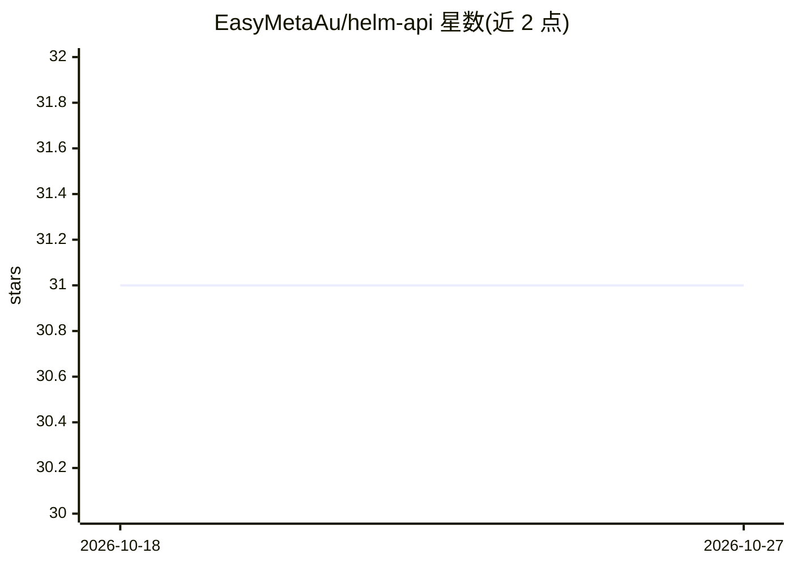

# EasyMetaAu/helm-api

⭐ 31 · TypeScript · MIT · 推送 2026-10-26 · [GitHub](https://github.com/EasyMetaAu/helm-api) · 组织维护 · 中文 README

**自托管 LLM 路由网关：按配置分发多协议流量并记录决策**

用 Hono/TypeScript 实现的开源自托管 LLM 网关，面向需要统一管理多家模型流量的开发者与团队。应用仅改 base_url 与 key 即可接入；网关对 OpenAI Chat、Anthropic Messages、OpenAI Responses、Gemini 请求做分类，经 lane（含有序回退链）选路，跨协议翻译并记录完整决策轨迹。还提供图像生成故障转移、OAuth 订阅账号作为后端、按 key 的限额与预算、可选记忆中间件、SQLite 默认存储及 SvelteKit 管理面板。Docker 或 Node≥22+pnpm10 源码构建安装；计费功能明确排除在范围外。

## 筛选速览

| 维度 | 判定 | 备注 |
|---|---|---|
| AI 角色 | `ai-ecosystem` | LLM/agent 周边工具 |
| 许可风险 | `permissive` | MIT |
| 部署形态 | `self-host` | docker 或自建部署 |
| 模型依赖 | locked-api |  |
| 硬件要求 | — | 无带数字的原话,不猜 |
| 安装摩擦 | `low` | 无编译、无系统依赖或容器化 |
| 成熟度 | — | 结构信号不足 |

## 能力要点

- 多协议文本路由（OpenAI Chat/Anthropic Messages/Responses/Gemini），协议不匹配时自动翻译
- 三层分类（确定性规则→可选小模型评估→默认 lane）与 lane 有序回退链
- OAuth 订阅（Claude Pro/Max、ChatGPT Codex、Copilot 等）可作为后端并池化多账号
- 每请求完整决策记录（分类、策略、各次尝试、成本），支持请求体检视与重放

## 适用场景

- 把散落在各客户端的模型回退与路由逻辑收敛为统一配置
- 将订阅账号池化为团队共享后端并做配额管理
- 跨 OpenAI/Anthropic/Gemini 协议复用同一客户端代码
- 排查某次请求为何被路由到某模型

## 场景标签

`模型网关` `LLM 可观测性` · 领域:Agent 开发

## 证据(README 行号)

> L20: Helm API puts that work in one place: an open-source, self-hosted **LLM routing gateway** — *nginx for the LLM worl
> L92: |🔀|**Multi-protocol text routing**|OpenAI Chat, Anthropic Messages, OpenAI Responses, and Google Gemini — streaming

## 星数曲线

2026-10-18 31 → 2026-10-27 31（+0）

---
*卡片 v1 · prompt 1.4 · 生成 2026-10-26 · 置信度 mid · 依据 README sha `04388dc9ed02` · [字段定义](../../DATASET.md)*
