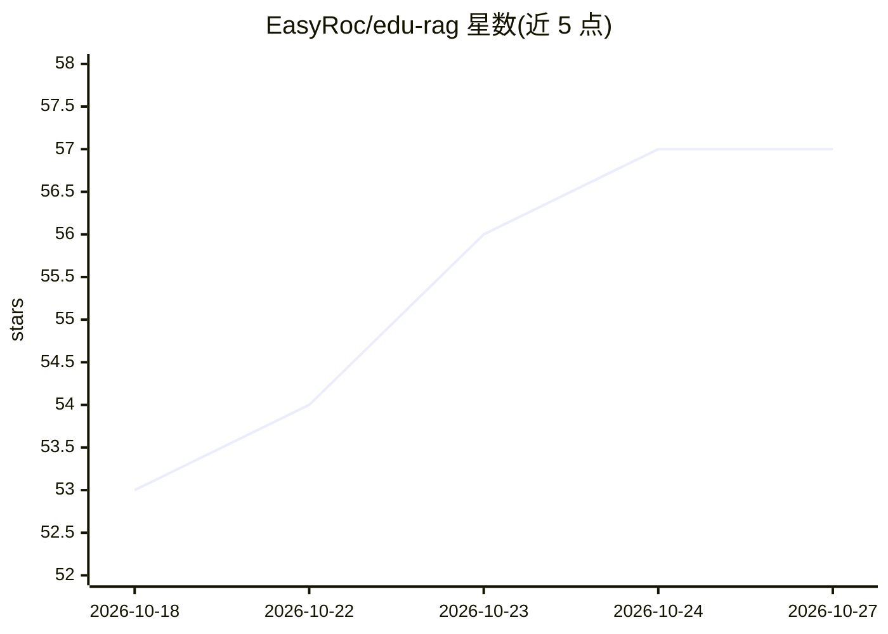

# EasyRoc/edu-rag

⭐ 57 · Python · 推送 2026-10-18 · [GitHub](https://github.com/EasyRoc/edu-rag) · [官网](https://github.com/EasyRoc/edu-rag) · 组织维护 · 中文 README

**面向 K12 教育的本地 RAG 知识库问答系统**

面向 K12 教材、教辅和校本资料的本地 RAG 系统，提供答疑、习题解析等问答服务。技术栈为 FastAPI REST/SSE 接口、LangGraph 编排问答流程、Milvus Lite 稠密检索 + 本地 BM25 + RRF 混合召回、bge CrossEncoder 重排与检索门控，证据不足时拒答。支持 PDF/Markdown/TXT 上传与 SQL 导入，内置 RAGAS 答案评估与独立检索评估。默认配置对接本地 Ollama 的 OpenAI 兼容接口，Embedding/Reranker 默认 CPU 运行。README 声明适合本地开发、演示与中小规模单机知识库，生产环境需补齐认证、数据库迁移等。

## 筛选速览

| 维度 | 判定 | 备注 |
|---|---|---|
| AI 角色 | `ai-native` | 本体是模型或模型工具 |
| 许可风险 | `none` | — |
| 部署形态 | `library` | 以包/库形式分发 |
| 模型依赖 | local-ok | 支持本地模型 |
| 硬件要求 | — | 无带数字的原话,不猜 |
| 安装摩擦 | `low` | 无编译、无系统依赖或容器化 |
| 成熟度 | — | 结构信号不足 |

## 能力要点

- Milvus Lite + BM25 + RRF 混合召回，CrossEncoder 重排与检索门控，证据不足时固定拒答
- 意图分类、多策略召回（direct/multi_query/decomposition）、复杂问题子答案并行生成与合成
- 文档上传（PDF/MD/TXT）、SQL 流式导入、RAGAS 答案评估与检索评估/门控校准双评估线
- 默认对接本地 Ollama OpenAI 兼容接口，Embedding/Reranker 本地 CPU 运行

## 适用场景

- 学校或教师把教材教辅建成知识库做答疑和导学
- 教育应用开发者基于 REST/SSE 接口集成问答能力
- 本地部署并用 RAGAS 与检索指标回归验证问答质量

## 场景标签

`文档问答` `RAG` · 领域:知识与检索

## 证据(README 行号)

> L1: # Edu-RAG：K12 教育知识库问答系统
> L3: Edu-RAG 是一个面向 K12 教材、教辅和校本资料的本地 RAG 系统。它使用 **FastAPI** 提供 REST/SSE 接口，使用 **LangGraph** 编排问答流程，使用 **Milvus Lite + BM2
> L92: |低质量拒答|检索证据不足时不进入 LLM 生成，返回固定拒答提示|

## 星数曲线

2026-10-18 53 → 2026-10-27 57（+4）

---
*卡片 v1 · prompt 1.4 · 生成 2026-10-24 · 置信度 mid · 依据 README sha `73cea4de153f` · [字段定义](../../DATASET.md)*
