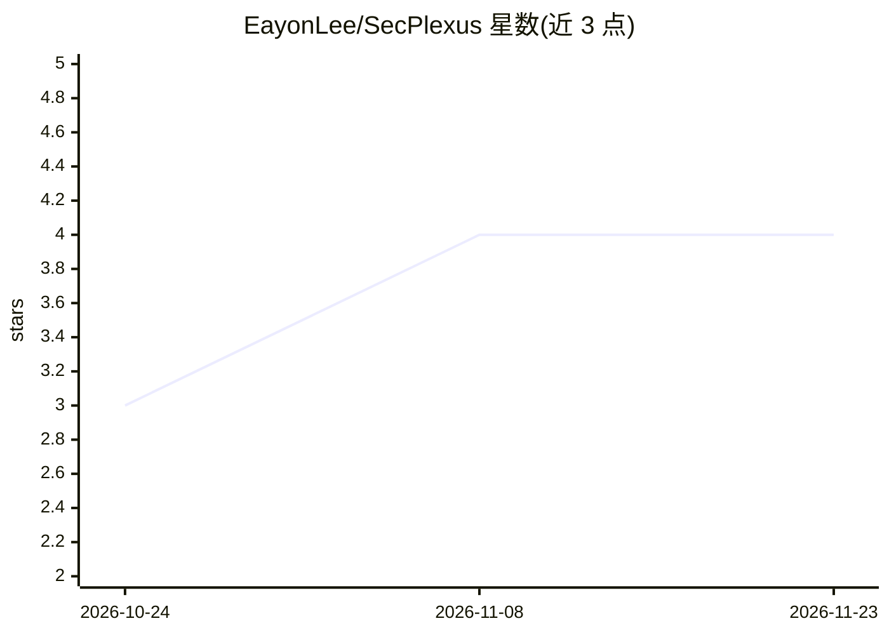

# EayonLee/SecPlexus

⭐ 4 · Go · MIT · 推送 2026-11-18 · [GitHub](https://github.com/EayonLee/SecPlexus) · [官网](https://www.secplexus.com) · 个人维护 · 中文 README

**面向 SOC 团队的开源 AI 安全运营平台**

定位于已有 SIEM/EDR/WAF/云安全之上的安全运营层：将多厂商告警归一化为 OCSF、去重关联并重建攻击链，由 AI 分析师对事件组做调查并输出三值结论（true positive / false positive / insufficient_info），经审批后由 SOAR 执行响应。同时提供 LLM/MCP 流量的内联 guardrail 与 agent 行为审计。技术栈为 Go + Next.js + PostgreSQL/Redis/Kafka/ClickHouse。README 明确项目处于 pre-1.0，当前仅控制面（IAM、Web、Console）已实现，数据面、AI 调查、响应编排等仍在开发中。

## 筛选速览

| 维度 | 判定 | 备注 |
|---|---|---|
| AI 角色 | `ai-native` | 本体是模型或模型工具 |
| 许可风险 | `permissive` | MIT |
| 部署形态 | `desktop` | 安装包/桌面程序 |
| 模型依赖 | — | README 未给出锁定关系 |
| 硬件要求 | — | 无带数字的原话,不猜 |
| 安装摩擦 | `low` | 无编译、无系统依赖或容器化 |
| 成熟度 | `idea` | |

## 能力要点

- 多厂商告警 OCSF 归一化、去重与跨源关联，重建攻击链事件视图
- AI 分析师按事件组调查，带 groundedness 门控与三值结论机制
- 面向 LLM/MCP 流量的内联 guardrail：prompt injection、DLP、模型密钥滥用
- AI 应用、agent、MCP server 与模型密钥作为一等资产纳入清单

## 适用场景

- 把分散在多家安全产品里的告警整合成一条攻击链来调查
- 为安全运营流程引入需人工审批的 AI 告警分诊与响应闭环
- 对企业内部的 LLM 应用、agent 和 MCP 工具调用做安全防护与审计

## 场景标签

`网络安全` · 领域:学习与行业

## 证据(README 行号)

> L5: SecPlexus is an open-source AI security operations platform for the modern SOC.
> L74: - **AI-native is an architecture, not a prompt.** The investigation unit is an
> L118: |AI|Graph-orchestrated agent runtime, `llm-gateway` (Bifrost core), NeMo Guardrails, `ai-gateway` (agentgateway)|

## 星数曲线

2026-10-24 3 → 2026-11-23 4（+1）

---
*卡片 v1 · prompt 1.4 · 生成 2026-11-21 · 置信度 mid · 依据 README sha `5cb5729bbf0d` · [字段定义](../../DATASET.md)*
