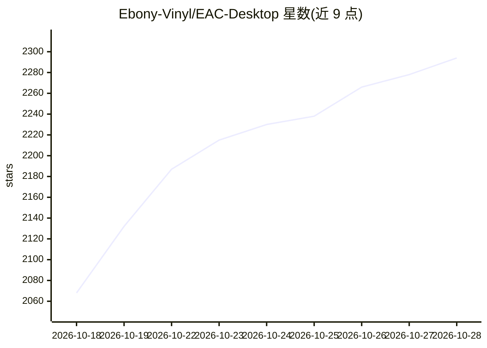

# Ebony-Vinyl/EAC-Desktop

⭐ 2,302 · JavaScript · MIT · 推送 2026-10-28 · [GitHub](https://github.com/Ebony-Vinyl/EAC-Desktop) · 组织维护 · 中文 README

**基于 DeepSeek Harness 的桌面 Agent 工作台，聚合数百个 DSH 插件**

基于 DeepSeek Harness 的开源桌面工作台（Tauri + Node sidecar 三层架构），将对话、项目文件、工具执行与插件生态整合进原生桌面：随包附带 Node.js、npm 与 dsh 运行时，启动本地 Web UI 承担会话与工具执行。提供插件目录聚合、安装启停、快照回滚保护、上下文压缩、DPX 独立环境管理与皮肤市场机制。模型调用由配置的提供商完成；DPX 不提供文件系统沙箱隔离。Windows 提供 v6.0.0 安装包，Linux/macOS 按各平台版本发布。

## 筛选速览

| 维度 | 判定 | 备注 |
|---|---|---|
| AI 角色 | `ai-native` | 本体是模型或模型工具 |
| 许可风险 | `permissive` | MIT |
| 部署形态 | `library` | 以包/库形式分发 |
| 模型依赖 | — | README 未给出锁定关系 |
| 硬件要求 | — | 无带数字的原话,不猜 |
| 安装摩擦 | `low` | 无编译、无系统依赖或容器化 |
| 成熟度 | — | 结构信号不足 |

## 能力要点

- 三层架构：Tauri 原生桌面（Rust）/ 运行编排（Node sidecar）/ Harness 内核（Agent）
- 随包附带 Node.js、npm 与 dsh 运行时，普通使用无需单独安装 Node.js
- 配套插件覆盖文件变更还原、上下文压缩、插件市场聚合、快照体检回滚等
- DPX 独立环境管理数据路径与运行时变量，按发布通道分离环境

## 适用场景

- 在桌面上一站式使用 DSH Agent 进行对话与项目文件协作
- 安装、启停与保护数百个 DSH 插件并获得回滚能力
- 通过市场安装皮肤自定义桌面外观

## 场景标签

`AI 助手` · 领域:对话与助手

## 证据(README 行号)

> L20: Deepseek Harness EAC 是基于 DeepSeek Harness 的开源桌面工作台。它将对话、项目文件、工具执行与插件生态连接起来，配合原生窗口、独立运行环境和随包运行时，让你从安装直接进入工作。
> L83: 4. **主窗口进入 Web UI**，由 Harness 承担会话与工具执行；桌面操作通过桥接层交给宿主。

## 星数曲线

2026-10-18 2,068 → 2026-10-28 2,294（+226）

---
*卡片 v1 · prompt 1.4 · 生成 2026-10-21 · 置信度 high · 依据 README sha `385cf89f9414` · [字段定义](../../DATASET.md)*
