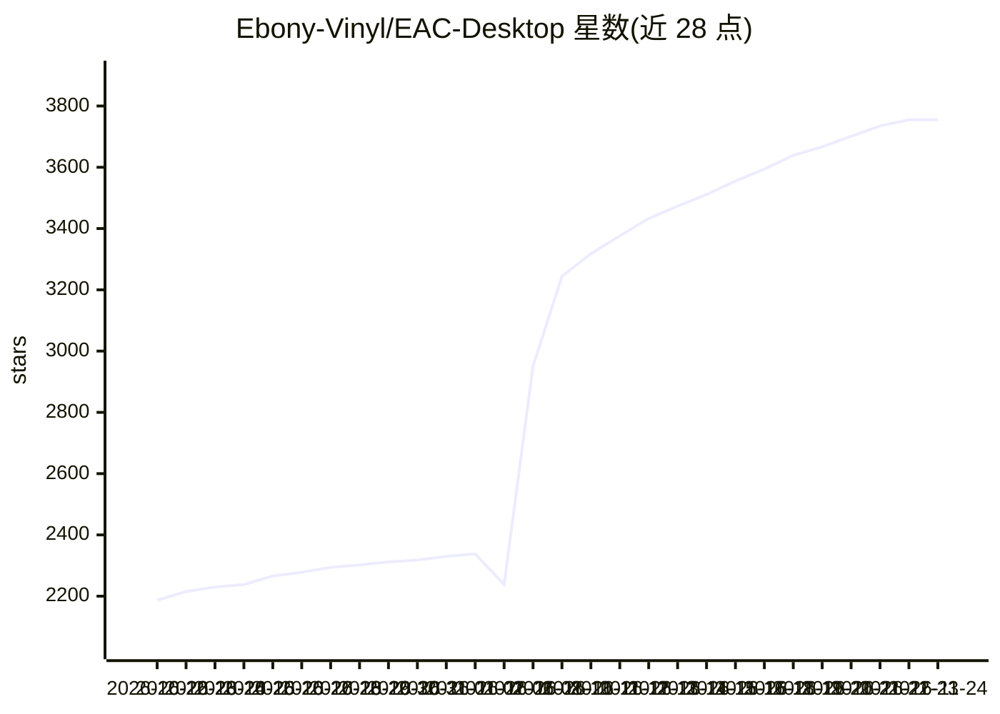

# Ebony-Vinyl/EAC-Desktop

⭐ 3,755 · JavaScript · MIT · 推送 2026-11-22 · [GitHub](https://github.com/Ebony-Vinyl/EAC-Desktop) · 组织维护 · 中文 README

**面向 Agent 用户的桌面工作台：整合对话、工具执行与 DSH 插件生态**

基于 DeepSeek Harness 的开源桌面工作台（Windows/Linux/macOS 安装包），将对话、项目文件变更、工具执行与插件生态接入 Tauri 原生窗口。架构分三层：Rust 壳负责窗口托盘、Node sidecar 负责进程编排与环境管理（DPX），Harness 内核承担 Agent 执行与 Web UI。随包自带 Node.js 运行时，普通使用无需另装 Node。提供文件变更还原、上下文压缩、插件安装/快照/回滚、皮肤市场等能力；插件按 builtin/recommended/external 分级。

## 筛选速览

| 维度 | 判定 | 备注 |
|---|---|---|
| AI 角色 | `ai-native` | 本体是模型或模型工具 |
| 许可风险 | `permissive` | MIT |
| 部署形态 | `library` | 以包/库形式分发 |
| 模型依赖 | — | README 未给出锁定关系 |
| 硬件要求 | — | 无带数字的原话,不猜 |
| 安装摩擦 | `low` | 无编译、无系统依赖或容器化 |
| 成熟度 | — | 结构信号不足 |

## 能力要点

- 三层架构：Tauri 原生壳 + Node sidecar 编排 + Harness Agent 内核
- 随包内置 Node.js 与 dsh 运行时，安装后可直接启动
- 插件聚合目录、快照/体检/回滚（dsh-plugin-shield）与皮肤市场契约
- 端到端加密 P2P 的 PC/Android/Web 远程接入与微信渠道插件

## 适用场景

- 在一个桌面窗口中运行 Agent 会话并管理项目文件变更
- 集中安装、启停与回滚数百个 DSH 插件
- 通过微信或 P2P 远程驱动本机会话

## 场景标签

`AI 助手` · 领域:对话与助手

## 证据(README 行号)

> L20: Deepseek Harness EAC 是基于 DeepSeek Harness 的开源桌面工作台。它将对话、项目文件、工具执行与插件生态连接起来，配合原生窗口、独立运行环境和随包运行时，让你从安装直接进入工作。
> L79: |**L3 · Harness 内核**|Agent 执行、对话、工具、Cordis 插件树与 Web UI|内核依赖|

## 星数曲线

2026-10-22 2,187 → 2026-11-24 3,755（+1,568）

---
*卡片 v1 · prompt 1.4 · 生成 2026-11-23 · 置信度 high · 依据 README sha `eee9734458f1` · [字段定义](../../DATASET.md)*
