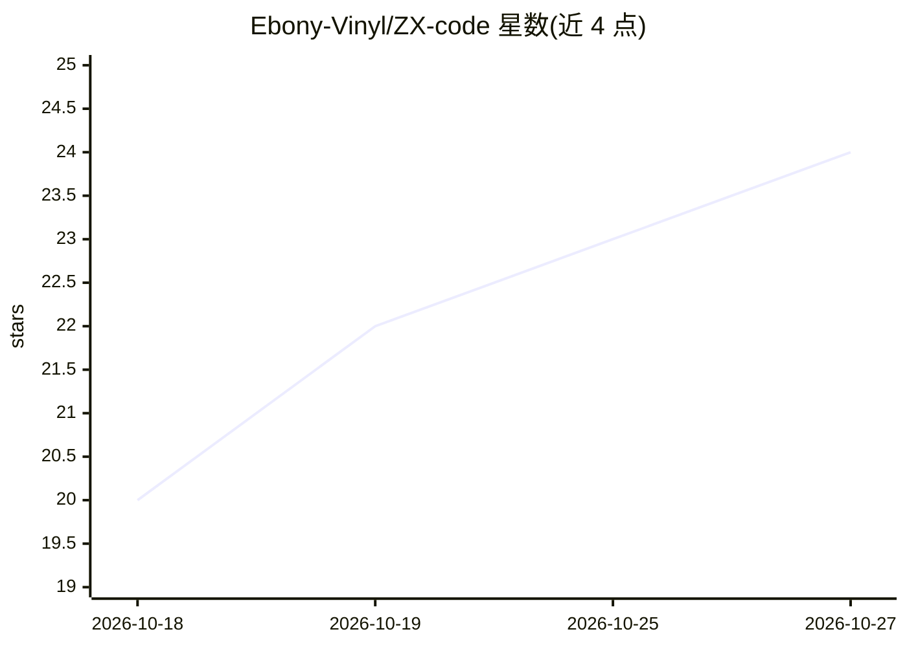

# Ebony-Vinyl/ZX-code

⭐ 24 · TypeScript · NOASSERTION · 推送 2026-10-05 · [GitHub](https://github.com/Ebony-Vinyl/ZX-code) · 个人维护 · 中文 README

**Windows 桌面 AI 编程 Agent，免 API Key 用国产大模型并带 3D 桌宠**

基于 Electron+React+TypeScript 的 Windows 桌面编程 Agent 应用：Agent 可读写文件、执行命令、搜索代码、联网查资料、派发子智能体，通过本地 OpenAI 兼容代理接入 9 家国产大模型网页版（DeepSeek/GLM/Kimi 等），OAuth 登录免 API Key。内置 3D 桌宠（SVG/VRM/Live2D）、九宫格多面板工作台、SQLite 记忆树与 Obsidian 导出、GEPA 技能自进化引擎、Cron 定时 Agent、用户画像、TTS 语音合成、脚本沙箱与 MCP 支持。提供安装包与源码构建两种部署方式。

## 筛选速览

| 维度 | 判定 | 备注 |
|---|---|---|
| AI 角色 | `ai-native` | 本体是模型或模型工具 |
| 许可风险 | `none` | NOASSERTION |
| 部署形态 | `desktop` | 安装包/桌面程序 |
| 模型依赖 | local-ok | 支持本地模型 |
| 硬件要求 | — | 无带数字的原话,不猜 |
| 安装摩擦 | `low` | 无编译、无系统依赖或容器化 |
| 成熟度 | — | 结构信号不足 |

## 能力要点

- 免 API Key 通过 OAuth 接入 9 家国产大模型网页版，含账号负载均衡
- 23 个内置工具与最多 20 轮迭代的多轮工具调用循环
- GEPA 技能自进化：自动生成变体、LLM-as-Judge 评分、阈值部署
- 记忆树六分区 + SuperContext 预热 + Obsidian 导出的长期记忆系统

## 适用场景

- 免 API Key 直接用国产大模型做代码生成、调试与重构
- 工作时用 3D 桌宠与角色化对话做编程陪伴
- 用定时 Agent 与脚本沙箱自动化批量任务
- 通过 MCP 与 SCL 技能扩展 Agent 能力

## 场景标签

`编码 Agent` · 领域:编码与开发

## 证据(README 行号)

> L22: ZX-Code 是一款运行于 Windows 的桌面端编程 Agent 智能体应用。它不止是一个 AI 聊天框——它是一个能**读写文件、执行命令、搜索代码、联网查资料、派发子任务**的全能编程伙伴，同时内置了**可交互的 3D 
> L71: - **内置代理引擎** — 通过本地 OpenAI 兼容代理接入 **9 家国内大模型网页版**（DeepSeek / GLM / Kimi / MiMo / MiniMax / Perplexity / Qwen / Qwen

## 星数曲线

2026-10-18 20 → 2026-10-27 24（+4）

---
*卡片 v1 · prompt 1.4 · 生成 2026-10-27 · 置信度 mid · 依据 README sha `08461a85ffd0` · [字段定义](../../DATASET.md)*
