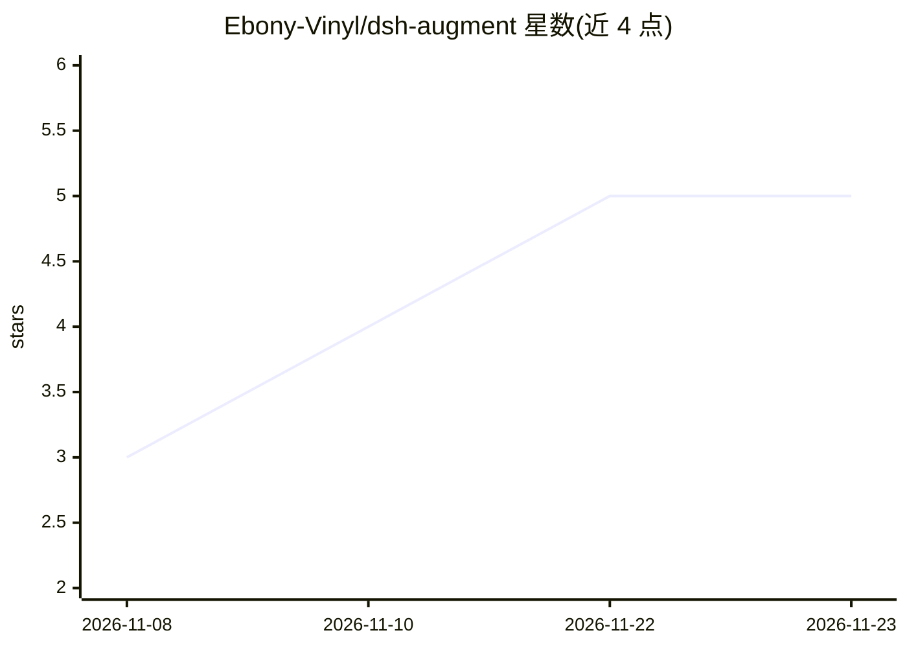

# Ebony-Vinyl/dsh-augment

⭐ 5 · JavaScript · MIT · 推送 2026-10-31 · [GitHub](https://github.com/Ebony-Vinyl/dsh-augment) · 个人维护 · 中文 README

**为 DeepSeek Harness 桌面端提供 token 压缩与自我进化的插件**

运行于 DeepSeek Harness 桌面端的插件，不改模型权重，通过 10+ 纯函数过滤器压缩工具输出、折叠重复读取、外置大结果并提供取回工具，同时以 token 账本展示每请求节省。自我进化部分含 8 个可进化组件（提示词/记忆/技能/模型路由等），采用 Propose–Probe–Compose 流程、四臂对比评测与统计采纳门，数据只存本机 `~/.dsh/dsh-augment`。安装需宿主 0.2.1-rc.2 ~ rc.5，git clone 后运行 node 脚本。

## 筛选速览

| 维度 | 判定 | 备注 |
|---|---|---|
| AI 角色 | `ai-ecosystem` | LLM/agent 周边工具 |
| 许可风险 | `permissive` | MIT |
| 部署形态 | `None` |  |
| 模型依赖 | — | README 未给出锁定关系 |
| 硬件要求 | — | 无带数字的原话,不猜 |
| 安装摩擦 | `low` | 无编译、无系统依赖或容器化 |
| 成熟度 | `idea` | |

## 能力要点

- 输出压缩含 never_worse 守卫，read 默认不做有损压缩
- CCR 外置原文保留 7 天，augment_retrieve 分页取回
- 四臂对比评测 + bootstrap CI + 回归门 + 一键回滚
- 纯 JS 运行时，零原生依赖，无遥测

## 适用场景

- 降低 DeepSeek Harness 会话的工具输出 token 消耗
- 查看每请求被工具 schema 与注入占用的 token 开销
- 在沙箱中持续进化提示词/记忆/技能并按证据采纳

## 场景标签

`提示工程` · 领域:Agent 开发

## 证据(README 行号)

> L10:  自适应驾驭层：Token 压缩 + 证据驱动的自我进化，为 DeepSeek Harness 桌面端设计。
> L36: node scripts/install.mjs
> L197: 要求：DeepSeek Harness 桌面端 0.2.1-rc.2 ~ 0.2.1-rc.5（`engines.dsh: >=0.2.0-rc.2 <0.3.0-0`；本版本在 0.2.1-rc.5 上实测），Windows 

## 星数曲线

2026-11-08 3 → 2026-11-23 5（+2）

---
*卡片 v1 · prompt 1.4 · 生成 2026-11-21 · 置信度 high · 依据 README sha `d5fd95c34bf4` · [字段定义](../../DATASET.md)*
