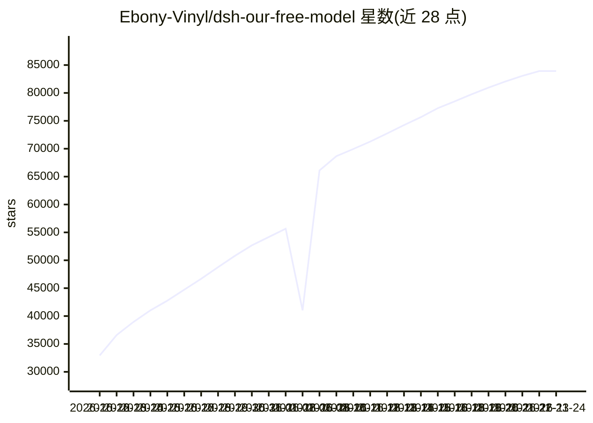

# Ebony-Vinyl/dsh-our-free-model

⭐ 85,063 · JavaScript · NOASSERTION · 推送 2026-11-23 · [GitHub](https://github.com/Ebony-Vinyl/dsh-our-free-model) · 个人维护 · 中文 README

**dsh 免费模型插件：免 Key 接入免费前沿模型与本地网关**

挂在 dsh 宿主上的纯插件，不改内核、零依赖、无构建步骤；无需账号或 API Key 即可使用免费车道模型（来源为 OpenCode Zen 网关与 Kilo 公共网关）。模型清单每次刷新向上游拉取，选择器按出口实测剔除不可用模型；思考强度按档位菜单或 token 预算真实下发。另提供 OpenAI/Anthropic 兼容本地转发端口、用量看板（数据留本机）、十账号渠道接入、聚合渠道（内置 76 家提供商注册表）与降级链路由。EAC 渠道需 GitHub 登录并 star 仓库，仅桌面端可用。

## 筛选速览

| 维度 | 判定 | 备注 |
|---|---|---|
| AI 角色 | `ai-ecosystem` | LLM/agent 周边工具 |
| 许可风险 | `none` | NOASSERTION |
| 部署形态 | `desktop` | 安装包/桌面程序 |
| 模型依赖 | local-ok | 支持本地模型 |
| 硬件要求 | — | 无带数字的原话,不猜 |
| 安装摩擦 | `low` | 无编译、无系统依赖或容器化 |
| 成熟度 | — | 结构信号不足 |

## 动量与使用信号

- 维护:`active` — 距上次 push 0.7 天,年发版 18,11 位贡献者
- 涨星:近 1 天 **+2,787**(自 20261016 起算)
- 下载:GitHub Release 附件 累计 23,786(24 个 release)
- 平台:— · 协议:OPENAI-API / OLLAMA

## 能力要点

- 免登录免 Key 使用免费车道模型，清单跟随上游实时刷新
- 本地网关提供 OpenAI 与 Anthropic 兼容端点，供其它工具调用
- 聚合渠道内置 76 家提供商注册表，Key 只写本机 0600 文件
- 用量看板、省 Token 压缩与命名降级链路由均在本机完成

## 适用场景

- 在 dsh 里不注册账号直接调用免费前沿模型
- 给本机其它工具配一个 OpenAI 兼容 base URL 复用同一批模型
- 把多个第三方端点的 Key 聚合进同一条模型清单统一管理
- 为关键调用配置降级链以应对配额限制

## 场景标签

`模型网关` · 领域:Agent 开发

## 证据(README 行号)

> L26: > 思考强度下发的是真实预算而不是提示词，另附一个 OpenAI 兼容的本地转发端口。
> L48: - **聚合渠道，自带 Key**——设置页新增一页，把第三方端点接进同一条模型清单：注册表内置 76 家提供商（NVIDIA NIM、OpenRouter、Groq、Cerebras、SambaNova、Gemini、DeepS
> L51: - **本地网关原生说 Anthropic**——新增 `POST /v1/messages`（流式与非流式，含 thinking / tool_use 块、真实 stop_reason 与流内 error 事件）与 `POST 

## 星数曲线

2026-10-22 32,941 → 2026-11-24 83,918（+50,977）

---
*卡片 v1 · prompt 1.4 · 生成 2026-11-24 · 置信度 high · 依据 README sha `b9e350f27116` · [字段定义](../../DATASET.md)*
