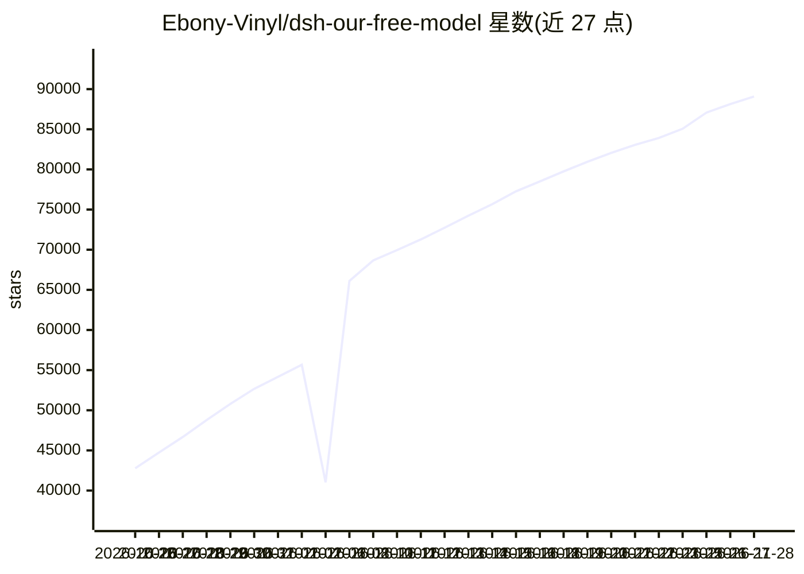

# Ebony-Vinyl/dsh-our-free-model

⭐ 89,087 · JavaScript · NOASSERTION · 推送 2026-11-27 · [GitHub](https://github.com/Ebony-Vinyl/dsh-our-free-model) · 个人维护 · 中文 README

**dsh 插件：免登录免 Key 接入免费模型与本地网关**

挂载在 dsh 宿主上的插件，提供免费模型车道：无需账号或 API Key，模型清单每次向上游网关实时拉取，不保存静态快照；按网络出口实测可用性并从选择器剔除被拒路由的模型。提供 OpenAI 兼容与 Anthropic 协议的本地转发端口、思考强度真实下发、EAC/Kilo 免费渠道、十个账号渠道接入、聚合渠道注册表（77 家提供商）、降级链路由、本地用量看板与 Token 压缩。安装依赖 dsh 宿主的 plugin 机制；独立服务入口开发中，安装制品尚未发布。

## 筛选速览

| 维度 | 判定 | 备注 |
|---|---|---|
| AI 角色 | `ai-ecosystem` | LLM/agent 周边工具 |
| 许可风险 | `none` | NOASSERTION |
| 部署形态 | `desktop` | 安装包/桌面程序 |
| 模型依赖 | local-ok | 支持本地模型 |
| 硬件要求 | — | 无带数字的原话,不猜 |
| 安装摩擦 | `low` | 无编译、无系统依赖或容器化 |
| 成熟度 | — | 结构信号不足 |

## 动量与使用信号

- 维护:`active` — 距上次 push 0.7 天,年发版 18,11 位贡献者
- 涨星:近 1 天 **+2,787**(自 20261016 起算)
- 下载:GitHub Release 附件 累计 23,786(24 个 release)
- 平台:— · 协议:OPENAI-API / OLLAMA

## 能力要点

- 免费车道无需账号、Key 或配额申请，清单跟随上游实时刷新
- 提供 OpenAI 兼容与 Anthropic 协议（/v1/messages）的本地转发端口
- 聚合渠道注册表内置 77 家提供商，Key 仅写入本机 0600 的 settings.json
- 免费车道按出口 IP 配额的 429 断路器与可配置出口代理

## 适用场景

- 在 dsh 里免注册直接调用 DeepSeek、Kimi 等免费模型
- 让本机其它工具通过本地网关 base_url 调用这些模型
- 把多个免费模型串成降级链，撞配额墙时自动切换

## 场景标签

`模型网关` · 领域:Agent 开发

## 证据(README 行号)

> L18: > 在 dsh 里装上插件即可使用免费车道，无需登录、注册或填写 API Key。
> L24: > 思考强度下发的是真实预算而不是提示词，另附一个 OpenAI 兼容的本地转发端口。
> L43: - **OpenAI 兼容转发端口**——本机其它工具通过 base URL 与 Key 即可调用这些模型。Chat 历史中 assistant 的字符串 `reasoning_content` 会随工具后续请求保留，包括显式空字

## 星数曲线

2026-10-26 42,764 → 2026-11-28 89,087（+46,323）

---
*卡片 v1 · prompt 1.4 · 生成 2026-11-28 · 置信度 high · 依据 README sha `a6d0ddea0b6e` · [字段定义](../../DATASET.md)*
