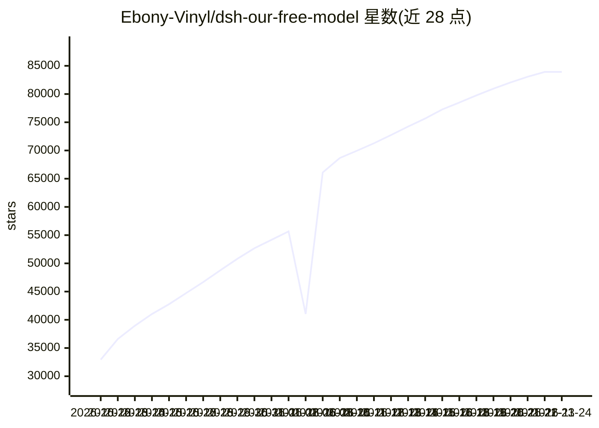

# Ebony-Vinyl/dsh-our-free-model

⭐ 83,918 · JavaScript · NOASSERTION · 推送 2026-11-22 · [GitHub](https://github.com/Ebony-Vinyl/dsh-our-free-model) · 个人维护 · 中文 README

**dsh 插件：免登录免 Key 直接使用免费前沿模型**

为 dsh（DeepSeek Harness）宿主提供的模型接入插件：挂载后无需登录、注册或 API Key 即可在模型选择器中使用上游免费网关的模型清单，清单随上游刷新并按本机网络出口实测可用性过滤。内置 Kilo 免费池、十账号渠道、聚合渠道（76 家提供商注册表）、OpenAI 与 Anthropic 兼容的本地转发端口、降级链路由、Token 压缩与用量看板。以纯插件形式安装，零依赖、无构建步骤；独立本地服务入口开发中，安装制品尚未发布。免费车道按出口 IP 计配额，插件内置断路器。

## 筛选速览

| 维度 | 判定 | 备注 |
|---|---|---|
| AI 角色 | `ai-ecosystem` | LLM/agent 周边工具 |
| 许可风险 | `none` | NOASSERTION |
| 部署形态 | `desktop` | 安装包/桌面程序 |
| 模型依赖 | — | README 未给出锁定关系 |
| 硬件要求 | — | 无带数字的原话,不猜 |
| 安装摩擦 | `low` | 无编译、无系统依赖或容器化 |
| 成熟度 | — | 结构信号不足 |

## 动量与使用信号

- 维护:`active` — 距上次 push 0.7 天,年发版 18,11 位贡献者
- 涨星:近 1 天 **+2,787**(自 20261016 起算)
- 下载:GitHub Release 附件 累计 23,786(24 个 release)
- 平台:— · 协议:OPENAI-API / OLLAMA

## 能力要点

- 免账号免 Key 使用上游免费网关模型，清单随上游实时刷新
- OpenAI 兼容转发端口（含 /v1/messages Anthropic 兼容接口），本机工具可直接调用
- 聚合渠道内置 76 家提供商注册表，聚合 Ollama、LM Studio、llama.cpp 等本地运行时
- 用量看板与运行日志数据全部留在本机，支持降级链路由与省 Token 压缩

## 适用场景

- 在 dsh 中不注册任何账号就使用 DeepSeek、Kimi 等免费模型
- 把本机其他工具经本地网关接入同一批免费模型
- 为多个第三方模型端点统一管理 Key、探测可用性并配置降级链

## 场景标签

`模型网关` · 领域:Agent 开发

## 证据(README 行号)

> L26: > 思考强度下发的是真实预算而不是提示词，另附一个 OpenAI 兼容的本地转发端口。
> L48: - **聚合渠道，自带 Key**——设置页新增一页，把第三方端点接进同一条模型清单：注册表内置 76 家提供商（NVIDIA NIM、OpenRouter、Groq、Cerebras、SambaNova、Gemini、DeepS
> L51: - **本地网关原生说 Anthropic**——新增 `POST /v1/messages`（流式与非流式，含 thinking / tool_use 块、真实 stop_reason 与流内 error 事件）与 `POST 

## 星数曲线

2026-10-22 32,941 → 2026-11-24 83,918（+50,977）

---
*卡片 v1 · prompt 1.4 · 生成 2026-11-23 · 置信度 high · 依据 README sha `153f5041ed28` · [字段定义](../../DATASET.md)*
