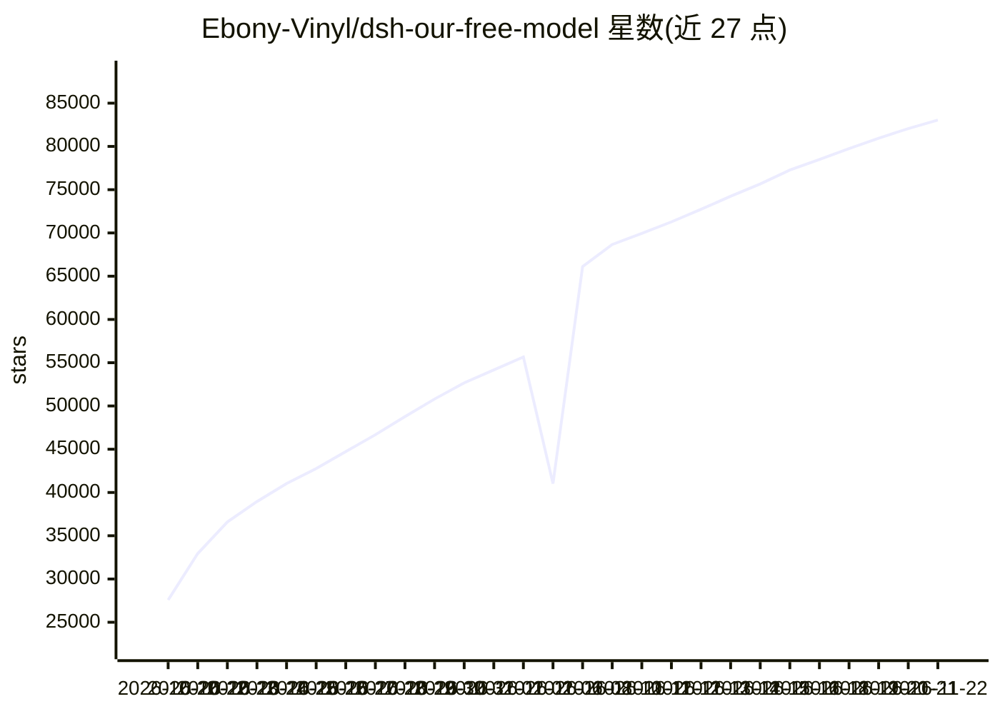

# Ebony-Vinyl/dsh-our-free-model

⭐ 83,055 · JavaScript · NOASSERTION · 推送 2026-11-21 · [GitHub](https://github.com/Ebony-Vinyl/dsh-our-free-model) · 个人维护 · 中文 README

**为 dsh 提供免 Key 免费模型接入的插件**

挂载在 dsh（DeepSeek Harness）上的插件，无需登录、注册或 API Key 即可使用免费车道的前沿模型（DeepSeek V4.1 Flash、Kimi K3 等）。机制：模型清单随上游实时刷新、按出口实测过滤可用模型、OpenAI/Anthropic 兼容本地转发端口、聚合 76 家自带 Key 的提供商注册表、十个账号渠道接入、降级链路由、用量看板（数据仅存本机）。支持 npm 与本地 tarball 安装；EAC 渠道需 GitHub 登录并 star 仓库。

## 筛选速览

| 维度 | 判定 | 备注 |
|---|---|---|
| AI 角色 | `ai-ecosystem` | LLM/agent 周边工具 |
| 许可风险 | `none` | NOASSERTION |
| 部署形态 | `desktop` | 安装包/桌面程序 |
| 模型依赖 | local-ok | 支持本地模型 |
| 硬件要求 | — | 无带数字的原话,不猜 |
| 安装摩擦 | `low` | 无编译、无系统依赖或容器化 |
| 成熟度 | — | 结构信号不足 |

## 动量与使用信号

- 维护:`active` — 距上次 push 0.7 天,年发版 18,11 位贡献者
- 涨星:近 1 天 **+2,787**(自 20261016 起算)
- 下载:GitHub Release 附件 累计 23,786(24 个 release)
- 平台:— · 协议:OPENAI-API / OLLAMA

## 能力要点

- 无需账号或 Key 的免费模型车道，清单随上游实时刷新
- OpenAI 兼容本地转发端口，另提供 Anthropic 协议端点 /v1/messages
- 聚合渠道内置 76 家提供商注册表，含 Ollama、LM Studio、llama.cpp 等免账号端点
- 应用内一键升级（SHA-256 校验、失败回滚）与热重载

## 适用场景

- 在 dsh 里直接使用免费模型，免注册免 Key
- 把本机其它工具接到 OpenAI 兼容转发端口调用这些模型
- 在设置页填第三方提供商 Key，把自有模型并进同一份清单

## 场景标签

`模型网关` · 领域:Agent 开发

## 证据(README 行号)

> L26: > 思考强度下发的是真实预算而不是提示词，另附一个 OpenAI 兼容的本地转发端口。
> L48: - **聚合渠道，自带 Key**——设置页新增一页，把第三方端点接进同一条模型清单：注册表内置 76 家提供商（NVIDIA NIM、OpenRouter、Groq、Cerebras、SambaNova、Gemini、DeepS
> L51: - **本地网关原生说 Anthropic**——新增 `POST /v1/messages`（流式与非流式，含 thinking / tool_use 块、真实 stop_reason 与流内 error 事件）与 `POST 

## 星数曲线

2026-10-20 27,577 → 2026-11-22 83,055（+55,478）

---
*卡片 v1 · prompt 1.4 · 生成 2026-11-22 · 置信度 mid · 依据 README sha `4cfaf860808e` · [字段定义](../../DATASET.md)*
