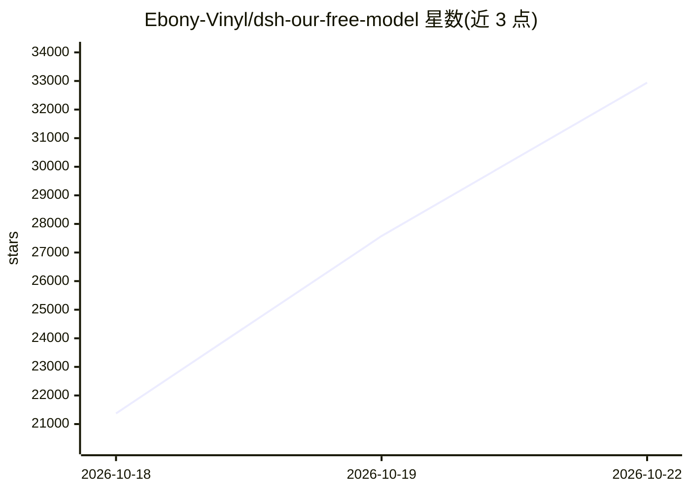

# Ebony-Vinyl/dsh-our-free-model

⭐ 32,941 · JavaScript · MIT · 推送 2026-10-21 · [GitHub](https://github.com/Ebony-Vinyl/dsh-our-free-model) · 个人维护 · 中文 README

**dsh 免费模型插件：免 Key 直连多家前沿模型**

面向 dsh（DeepSeek Harness）的模型接入插件：不注册、不填 API Key 即可使用 OpenCode Zen 网关与 Kilo AI 公共网关提供的免费模型（DeepSeek、Kimi 等），模型清单每次刷新向上游拉取。另含 EAC 协付渠道、十三个账号渠道聚合、75 家自带 Key 提供商的聚合注册表、OpenAI/Anthropic 兼容的本地转发端口、降级路由链、工具输出压缩与本地用量看板。提供独立本地服务（标注开发中）。限制：上游免费池可能记录 prompt；安装须用本仓库 Release 或源码目录，README 明确警告 npm 同名包为第三方改动版本。

## 筛选速览

| 维度 | 判定 | 备注 |
|---|---|---|
| AI 角色 | `ai-ecosystem` | LLM/agent 周边工具 |
| 许可风险 | `permissive` | MIT |
| 部署形态 | `desktop` | 安装包/桌面程序 |
| 模型依赖 | local-ok | 支持本地模型 |
| 硬件要求 | — | 无带数字的原话,不猜 |
| 安装摩擦 | `low` | 无编译、无系统依赖或容器化 |
| 成熟度 | `idea` | |

## 动量与使用信号

- 维护:`active` — 距上次 push 0.7 天,年发版 18,11 位贡献者
- 涨星:近 1 天 **+2,787**(自 20261016 起算)
- 下载:GitHub Release 附件 累计 23,786(24 个 release)
- 平台:— · 协议:OPENAI-API / OLLAMA

## 能力要点

- 免账号免 Key 直连 OpenCode Zen 与 Kilo 公共网关的免费模型车道
- OpenAI 兼容本地转发端口，另支持 Anthropic Messages 协议（含流式与 count_tokens）
- 聚合 75 家自带 Key 提供商（含 Ollama、LM Studio、llama.cpp 等免账号本地运行时）
- 降级路由链、工具输出压缩（RTK）与本地用量看板（数据不上传）

## 适用场景

- 在 dsh 中不配置任何 Key 直接调用前沿模型
- 让本机其它工具通过 OpenAI/Anthropic 兼容端口调用这些模型
- 把自有 Key 的多家提供商接入同一条模型清单并做降级路由

## 场景标签

`模型网关` · 领域:Agent 开发

## 证据(README 行号)

> L18: > 你只需在 dsh 里装上这个插件，无需登录、注册、填 API Key 或任何其它操作，
> L51: - **OpenAI 兼容转发端口**——本机其它工具通过 base URL 与 Key 即可调用这些模型。
> L54: - **聚合渠道，自带 Key**——设置页新增一页，把第三方端点接进同一条模型清单：注册表内置 75 家提供商（NVIDIA NIM、OpenRouter、Groq、Cerebras、SambaNova、Gemini、DeepS

## 星数曲线

2026-10-18 21,372 → 2026-10-22 32,941（+11,569）

---
*卡片 v1 · prompt 1.4 · 生成 2026-10-20 · 置信度 high · 依据 README sha `60e7b01bf3e1` · [字段定义](../../DATASET.md)*
