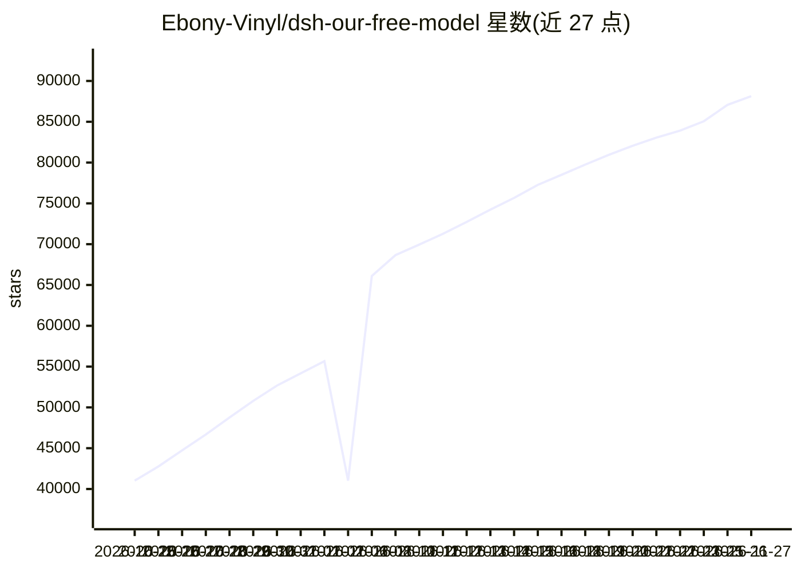

# Ebony-Vinyl/dsh-our-free-model

⭐ 88,142 · JavaScript · NOASSERTION · 推送 2026-11-26 · [GitHub](https://github.com/Ebony-Vinyl/dsh-our-free-model) · 个人维护 · 中文 README

**dsh 插件：免登录免 Key 接入免费 LLM 模型车道**

面向 dsh 宿主的纯插件，不改内核、零依赖、无构建步骤，挂载后无需账号或 API Key 即可使用免费车道模型（上游为 OpenCode Zen 网关与 Kilo AI 公共网关）。提供模型选择器与可用性探测、思考强度下发、用量看板、本地 OpenAI 兼容/Anthropic 兼容转发端口、聚合渠道（内置 77 家提供商注册表）、降级链路由与插件中心。注意 npm 裸名包非本仓库发布，官方渠道为带 scope 的包与本地 tarball。

## 筛选速览

| 维度 | 判定 | 备注 |
|---|---|---|
| AI 角色 | `ai-ecosystem` | LLM/agent 周边工具 |
| 许可风险 | `none` | NOASSERTION |
| 部署形态 | `desktop` | 安装包/桌面程序 |
| 模型依赖 | local-ok | 支持本地模型 |
| 硬件要求 | — | 无带数字的原话,不猜 |
| 安装摩擦 | `low` | 无编译、无系统依赖或容器化 |
| 成熟度 | — | 结构信号不足 |

## 动量与使用信号

- 维护:`active` — 距上次 push 0.7 天,年发版 18,11 位贡献者
- 涨星:近 1 天 **+2,787**(自 20261016 起算)
- 下载:GitHub Release 附件 累计 23,786(24 个 release)
- 平台:— · 协议:OPENAI-API / OLLAMA

## 能力要点

- 免登录、免注册、免 API Key 的免费模型车道
- 内置 77 家提供商注册表的聚合渠道，写入 Key 即并入模型清单
- 本地转发端口提供 OpenAI 兼容与 Anthropic 兼容接口
- 模型清单跟随上游刷新，不可用模型从选择器移除并注明拒因

## 适用场景

- 在 dsh 里直接调用免费前沿模型而不注册任何账号
- 本机其它工具通过 base URL 调用这些模型
- 聚合多家 LLM 提供商到同一模型清单统一管理

## 场景标签

`模型网关` · 领域:Agent 开发

## 证据(README 行号)

> L24: > 思考强度下发的是真实预算而不是提示词，另附一个 OpenAI 兼容的本地转发端口。
> L46: - **聚合渠道，自带 Key**——设置页新增一页，把第三方端点接进同一条模型清单：注册表内置 77 家提供商（NVIDIA NIM、OpenRouter、Groq、Cerebras、SambaNova、Gemini、DeepS
> L49: - **本地网关原生说 Anthropic**——新增 `POST /v1/messages`（流式与非流式，含 thinking / tool_use 块、真实 stop_reason 与流内 error 事件）与 `POST 

## 星数曲线

2026-10-25 41,024 → 2026-11-27 88,142（+47,118）

---
*卡片 v1 · prompt 1.4 · 生成 2026-11-26 · 置信度 high · 依据 README sha `7f59fdd45e01` · [字段定义](../../DATASET.md)*
