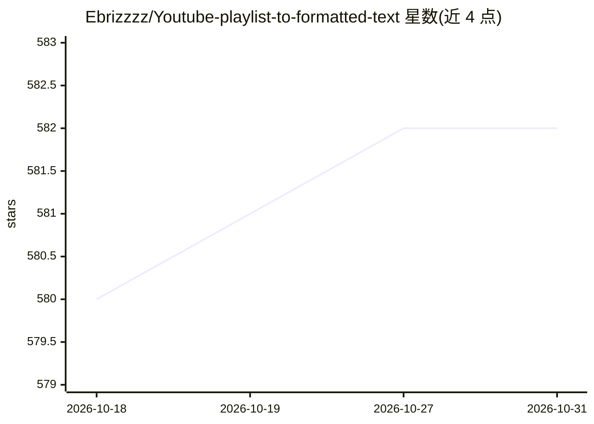

# Ebrizzzz/Youtube-playlist-to-formatted-text

⭐ 582 · Python · MIT · 推送 2026-02-17 · [GitHub](https://github.com/Ebrizzzz/Youtube-playlist-to-formatted-text) · 个人维护

**把 YouTube 播放列表字幕经 Gemini 精炼成结构化电子书文本的桌面工具**

基于 PyQt5 的桌面应用：输入 YouTube 播放列表或单个视频链接，抓取每条视频的字幕，按可配置的分块大小（默认 3000 词，滑块可调）逐块送入 Google Gemini API 精炼，前文精炼结果作为上下文拼接以保持连贯，最终输出为 Markdown 文件。提供五种精炼风格（均衡详尽、摘要、教科书式、叙事改写、问答生成），输出语言由用户指定。运行需 Python 3.9+ 与用户自备的免费 Gemini API key，通过 python main.py 启动图形界面。

## 筛选速览

| 维度 | 判定 | 备注 |
|---|---|---|
| AI 角色 | `ai-native` | 本体是模型或模型工具 |
| 许可风险 | `permissive` | MIT |
| 部署形态 | `library` | 以包/库形式分发 |
| 模型依赖 | — | README 未给出锁定关系 |
| 硬件要求 | — | 无带数字的原话,不猜 |
| 安装摩擦 | `low` | 无编译、无系统依赖或容器化 |
| 成熟度 | — | 结构信号不足 |

## 能力要点

- 批量提取整个播放列表的字幕并用 Gemini 精炼
- 五种精炼风格：均衡详尽/摘要/教育式/叙事改写/问答生成
- 分块处理携带前文上下文保持连贯，分块大小可调
- 输出语言由用户指定，视频可为任意有字幕的语言

## 适用场景

- 把长视频课程播放列表整理成可阅读的 Markdown 笔记或电子书
- 生成摘要或问答格式的内容用于复习备考
- 将整理后的文本作为 NotebookLM 或 Obsidian 的输入源

## 场景标签

`AI 写作` `网页抓取` · 领域:效率与自动化

## 证据(README 行号)

> L32: This Python application extracts transcripts from YouTube playlists and refines them using the Google Gemini API(wh
> L41: * Refine transcripts using Google Gemini API for improved formatting and readability.

## 星数曲线

2026-10-18 580 → 2026-10-31 582（+2）

---
*卡片 v1 · prompt 1.4 · 生成 2026-10-21 · 置信度 high · 依据 README sha `fff6f749554a` · [字段定义](../../DATASET.md)*
