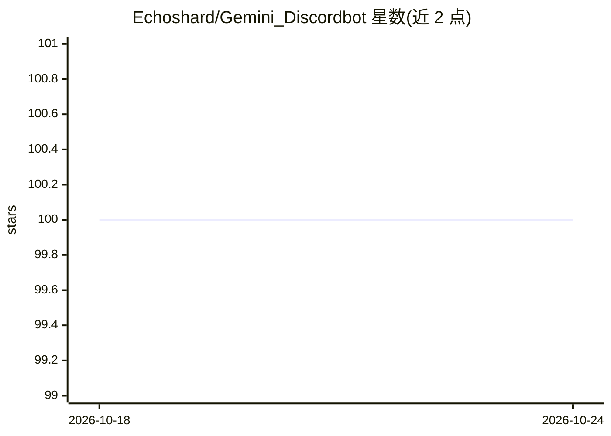

# Echoshard/Gemini_Discordbot

⭐ 100 · Python · MIT · 推送 2025-11-17 · [GitHub](https://github.com/Echoshard/Gemini_Discordbot) · 个人维护

**接入 Gemini API 的 Discord 对话机器人，支持图文与记忆**

Python 编写的 Discord 机器人，调用 Google Gemini API（现使用 Gemini Flash 1.5）生成回复。支持文本与图片输入（图片需小于 2.5MB）、按 Discord ID 维护用户消息历史以实现上下文对话、解析 YouTube 字幕、读取 PDF/TXT 文件及抓取网页文本。通过提及或私信激活，用 .env 配置 Discord bot token 与 Google AI API key，pip 安装依赖后运行 GeminiDiscordBot.py。另提供仅支持文本和图片的精简版 GeminiSimple.py。已知限制：Google Docs URL 无法正确解析，部分 URL 解析失败，年龄限制视频的字幕无法读取。

## 筛选速览

| 维度 | 判定 | 备注 |
|---|---|---|
| AI 角色 | `ai-native` | 本体是模型或模型工具 |
| 许可风险 | `permissive` | MIT |
| 部署形态 | `library` | 以包/库形式分发 |
| 模型依赖 | — | README 未给出锁定关系 |
| 硬件要求 | — | 无带数字的原话,不猜 |
| 安装摩擦 | `low` | 无编译、无系统依赖或容器化 |
| 成熟度 | — | 结构信号不足 |

## 能力要点

- 按 Discord ID 维护用户消息历史，支持上下文对话
- 支持图片、PDF/TXT、YouTube 字幕与网页文本作为输入
- 提供精简版 GeminiSimple.py
- 用户可配置历史长度与 AI 响应参数

## 适用场景

- 在 Discord 服务器中与 Gemini 进行文本和图片对话
- 向机器人发送 YouTube 链接或网页并提问
- 读取 PDF/TXT 并基于内容生成回复

## 场景标签

`聊天机器人` · 领域:对话与助手

## 证据(README 行号)

> L3:  Discord bot that leverages the power of Google's Gemini-Pro API to interact with users in both text and image forma
> L13: - **AI-Driven Text Responses:** Gemini Bot can generate text responses to messages using Google's generative AI.

## 星数曲线

2026-10-18 100 → 2026-10-24 100（+0）

---
*卡片 v1 · prompt 1.4 · 生成 2026-10-23 · 置信度 high · 依据 README sha `f900ee2295b0` · [字段定义](../../DATASET.md)*
