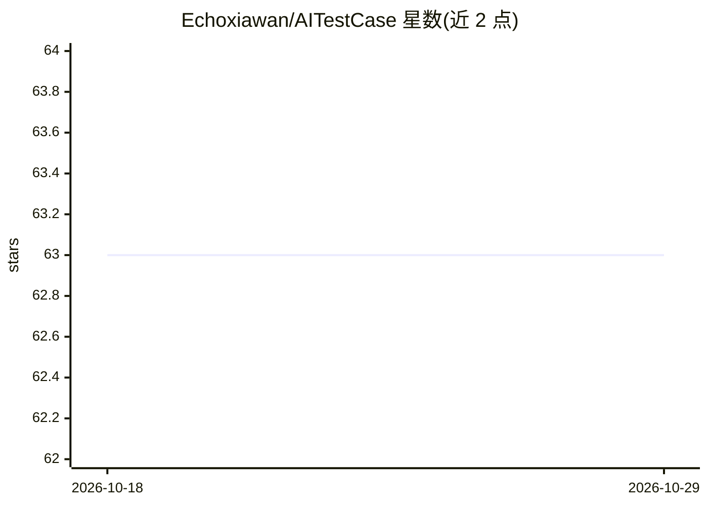

# Echoxiawan/AITestCase

⭐ 63 · Python · MIT · 推送 2026-05-12 · [GitHub](https://github.com/Echoxiawan/AITestCase) · 个人维护 · 中文 README

**基于网页与需求文档自动生成测试用例的工具**

命令行与 Web 界面工具：以 Playwright 驱动浏览器读取目标页面内容，结合需求文档（纯文本/Markdown/DOCX）由 AI 生成测试用例，并可将用例与需求关联后导出为 Excel。支持账号密码与 Cookie（键值格式）两种登录方式，可选用 AI 自动识别登录表单元素。安装需 Python 3.9+，pip 安装依赖并执行 playwright install；采用 GPL 许可证。

## 筛选速览

| 维度 | 判定 | 备注 |
|---|---|---|
| AI 角色 | `ai-native` | 本体是模型或模型工具 |
| 许可风险 | `permissive` | MIT |
| 部署形态 | `library` | 以包/库形式分发 |
| 模型依赖 | — | README 未给出锁定关系 |
| 硬件要求 | — | 无带数字的原话,不猜 |
| 安装摩擦 | `low` | 无编译、无系统依赖或容器化 |
| 成熟度 | — | 结构信号不足 |

## 能力要点

- 结合当前页面与需求文档生成测试用例
- 支持账号密码与键值格式 Cookie 登录，可选 AI 识别登录元素
- 需求文档支持纯文本/Markdown/DOCX，用例导出 Excel
- 提供命令行与 Web 界面（默认 5000 端口）两种使用方式

## 适用场景

- 测试人员根据页面与需求文档快速产出测试用例
- 需要登录的站点自动生成并导出用例到 Excel
- 通过 Web 界面配置 URL、登录方式与需求文档批量生成用例

## 场景标签

`网页抓取` · 领域:效率与自动化

## 证据(README 行号)

> L7: - 📋 **Test Case Generation**: Automatically generate test cases based on the current page and requirement document c
> L87: python main.py --url https://example.com --login-url https://example.com/login --username user --password pass --us

## 星数曲线

2026-10-18 63 → 2026-10-29 63（+0）

---
*卡片 v1 · prompt 1.4 · 生成 2026-10-24 · 置信度 mid · 依据 README sha `257097785fd9` · [字段定义](../../DATASET.md)*
