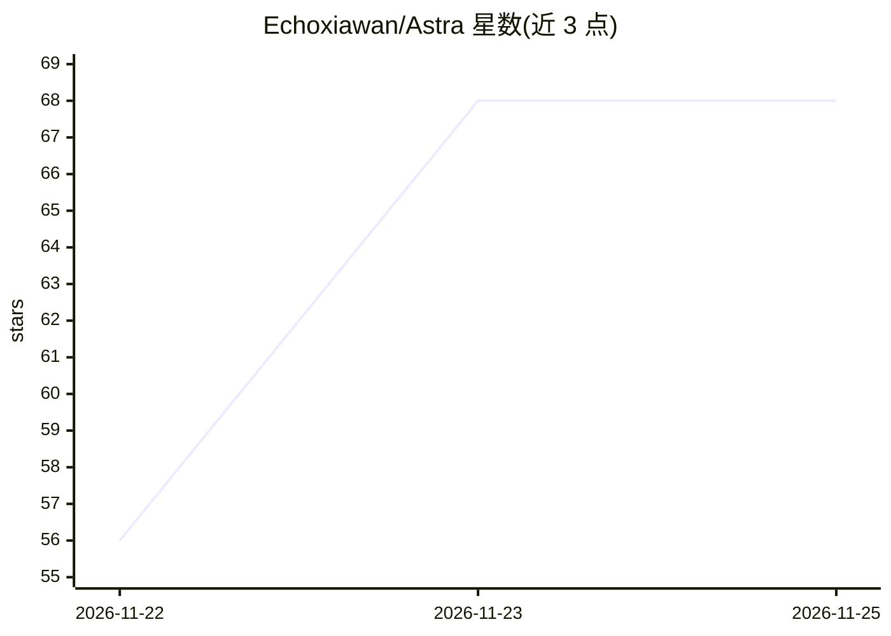

# Echoxiawan/Astra

⭐ 68 · Python · Apache-2.0 · 推送 2026-11-23 · [GitHub](https://github.com/Echoxiawan/Astra) · 个人维护 · 中文 README

**用自然语言在真机上跑移动端 UI 测试并生成 pytest+Appium 脚本**

面向真实 Android/iOS 设备的开源 UI 自动化测试平台。测试人员用自然语言描述前置条件、操作与断言，平台结合多模态模型与 Appium 读取页面树和截图、定位元素并执行动作；AI 模式跑通单个非调试用例后可导出独立 pytest+Appium 脚本供回归使用，不再调用 AI。平台同时管理设备、应用版本、用例、套件、计划、执行与报告，部署依赖 MySQL、Redis、Appium 与阿里云 OSS。

## 筛选速览

| 维度 | 判定 | 备注 |
|---|---|---|
| AI 角色 | `ai-native` | 本体是模型或模型工具 |
| 许可风险 | `permissive` | Apache-2.0 |
| 部署形态 | `self-host` | docker 或自建部署 |
| 模型依赖 | — | README 未给出锁定关系 |
| 硬件要求 | — | 无带数字的原话,不猜 |
| 安装摩擦 | `low` | 无编译、无系统依赖或容器化 |
| 成熟度 | — | 结构信号不足 |

## 能力要点

- AI 执行与脚本捕获：成功运行轨迹导出为独立 pytest + Appium 脚本
- 双执行模式：AI 执行（生成脚本）与脚本执行（无 AI 调用的批量回归）
- 多设备调度：设备内串行、跨设备并行，支持平台/分组/标签过滤
- 测试管理闭环：应用、版本、模块、用例、套件、计划、执行与报告

## 适用场景

- 新用例探索期用自然语言驱动真机执行并沉淀脚本
- 稳定用例转入脚本模式做每日与批量回归
- 团队管理移动端测试用例、套件、计划与执行报告
- 导入 Echobench 导出的用例 CSV 与 Appium 脚本复用

## 场景标签

`GUI 自动化` `代码生成` · 领域:效率与自动化

## 证据(README 行号)

> L17: Astra is an open-source UI automation platform for real Android and iOS devices. Testers describe preconditions, ac
> L36: |AI execution|Yes|New cases, exploration, initial script generation|Generates a script after a manual, non-debug si
> L41: - **AI execution and script capture** — Multimodal models read the page tree and screenshots; successful traces bec

## 星数曲线

2026-11-22 56 → 2026-11-25 68（+12）

---
*卡片 v1 · prompt 1.4 · 生成 2026-11-22 · 置信度 high · 依据 README sha `7e4c1fd18b6e` · [字段定义](../../DATASET.md)*
