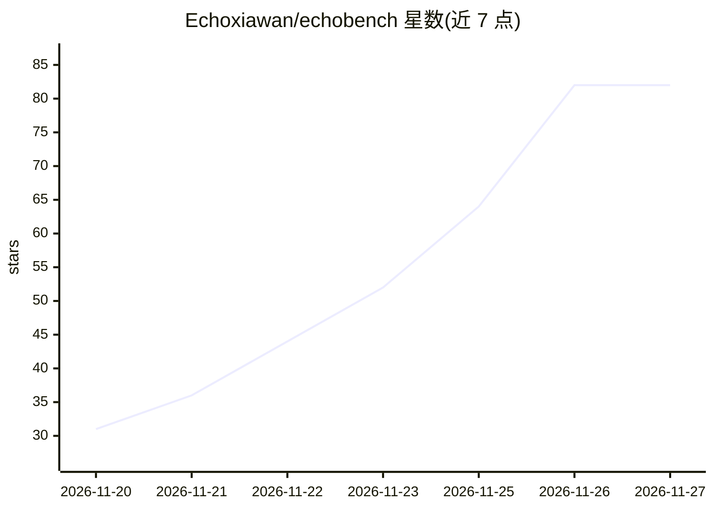

# Echoxiawan/echobench

⭐ 82 · TypeScript · Apache-2.0 · 推送 2026-11-18 · [GitHub](https://github.com/Echoxiawan/echobench) · 个人维护 · 中文 README

**给移动 QA/开发的本机优先测试台：录制、回放、多端同步与 AI 导出**

本机优先的 Android/iOS 移动测试工作台：在本地浏览器操作设备镜像，通过 Appium 控件树识别元素，把点击、输入、滑动等动作记录为可编辑、可回放的 YAML DSL；支持实时定位器校验、一台操作多台同步执行、断言、附加已有 Appium 会话，以及 WebdriverIO/Python/Java 三种脚本导出。AI 为可选能力：配置 OpenAI 兼容接口后按步骤导出用例 CSV。可源码运行或打包为 Electron 桌面版，数据、日志与 AI 配置均留在本机，无账号与云依赖；iOS 自动化仅限 macOS。

## 筛选速览

| 维度 | 判定 | 备注 |
|---|---|---|
| AI 角色 | `ai-enhanced` | 去掉 AI 部分产品仍成立 |
| 许可风险 | `permissive` | Apache-2.0 |
| 部署形态 | `None` |  |
| 模型依赖 | — | README 未给出锁定关系 |
| 硬件要求 | — | 无带数字的原话,不猜 |
| 安装摩擦 | `medium` | 含编译或系统依赖之一 |
| 成熟度 | — | 结构信号不足 |

## 能力要点

- 录制操作为可编辑、可回放的 YAML DSL，并可导出 WebdriverIO/Python/Java 脚本
- 多策略候选定位器生成与实时唯一性校验，主定位失效按安全候选降级
- 一台设备操作广播到多台 Android/iOS 设备同步执行
- scrcpy-server 经 ADB reverse 推 H.264，浏览器 WebCodecs 直接解码画面

## 适用场景

- 在本机录制手工操作步骤并回放，替代纯手点测试
- 同一操作流程在多台真机/模拟器上同步执行做兼容性对比
- 把录制步骤导出为 Python/Java 脚本过渡到代码化测试
- 配置本地模型或 OpenAI 兼容接口导出测试用例 CSV

## 场景标签

`GUI 自动化` · 领域:效率与自动化

## 证据(README 行号)

> L18: EchoBench 是一个**本机优先**的移动测试工作台。人在浏览器中点击设备镜像，工具同步操作真机或模拟器，通过 Appium 控件树识别目标，并把点击、输入、滑动、返回等动作记录为可编辑、可回放的 YAML DSL。它同时支
> L44: - **AI 自主可控** — AI 只是可选能力，支持任意 OpenAI 兼容接口，也可接本地模型。
> L47: 适合需要本机调试、兼容性对比和从手工步骤过渡到脚本的 QA/开发；不适合大规模云真机矩阵或企业级测试管理。完整对比见 同类产品对比。

## 星数曲线

2026-11-20 31 → 2026-11-27 82（+51）

---
*卡片 v1 · prompt 1.4 · 生成 2026-11-20 · 置信度 high · 依据 README sha `949dd335fbd6` · [字段定义](../../DATASET.md)*
