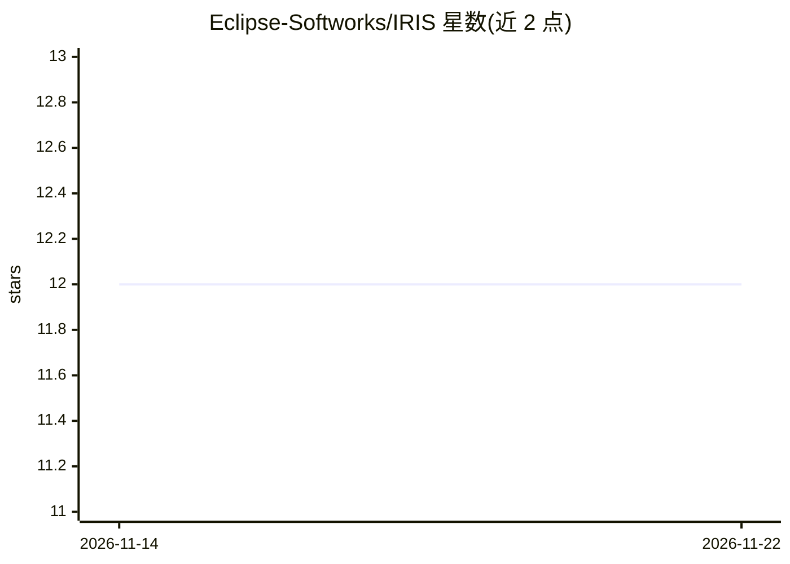

# Eclipse-Softworks/IRIS

⭐ 12 · Rust · Apache-2.0 · 推送 2026-11-20 · [GitHub](https://github.com/Eclipse-Softworks/IRIS) · [官网](https://iris-lang.dev) · 组织维护

**面向智能/并发/信息物理软件的静态类型双后端编程语言**

IRIS 是一门静态类型编程语言及其单一工具链，统一 Python 建模与 C/C++ 低层控制的分层栈：前端经类型/借用/效应检查生成 SSA IR，支持 16 种 --emit 模式（二进制、JIT、CUDA、ONNX、TensorRT 等）。语言级提供逆向自动微分、运行时动态加载 ONNX Runtime/TensorFlow C API/LibTorch 后端、RL 与 LLM 标准库模块，并含 ROS 2 客户端栈、微控制器代码生成和 7 门验证的受治理自演化机制。需用 cargo 从源码构建，Windows 原生二进制依赖 LLVM 23.1.1 工具链。

## 筛选速览

| 维度 | 判定 | 备注 |
|---|---|---|
| AI 角色 | `ai-ecosystem` | LLM/agent 周边工具 |
| 许可风险 | `viral` | Apache-2.0 |
| 部署形态 | `desktop` | 安装包/桌面程序 |
| 模型依赖 | — | README 未给出锁定关系 |
| 硬件要求 | — | 无带数字的原话,不猜 |
| 安装摩擦 | `high` | 编译与系统依赖俱全 |
| 成熟度 | — | 结构信号不足 |

## 能力要点

- 语言级逆向自动微分（tape/backward/grad）
- 运行时 dlopen 发现 ONNX Runtime/TensorFlow C API/LibTorch 后端，未用时不依赖编译期 SDK
- 16 种 --emit 模式，含 cuda/cuda-ptx/onnx/tensorrt/python-ext
- 7 门宪法验证的受治理自演化与哈希链审计

## 适用场景

- 在同一工具链中编写并训练 ML/RL 模型并部署为原生二进制
- 通过 ROS 2 标准库开发机器人控制软件
- 为 cortex-m4f/esp32 等微控制器生成免堆分配的嵌入式代码
- 需要带事务回滚与审计链的自我演化服务

## 场景标签

 · 领域:编程语言/开发工具链

## 证据(README 行号)

> L9: IRIS is a statically typed, dual-backend programming language designed to build, train, verify, deploy, and safely e
> L32: ### 2. Machine Learning, Autodiff & LLM Tooling
> L34: - **Runtime-loaded ML backends** (docs/ml-backends.md): dynamically discovers **ONNX Runtime**, **TensorFlow C API*

## 星数曲线

2026-11-14 12 → 2026-11-22 12（+0）

---
*卡片 v1 · prompt 1.4 · 生成 2026-11-18 · 置信度 high · 依据 README sha `9bf5a11e7914` · [字段定义](../../DATASET.md)*
