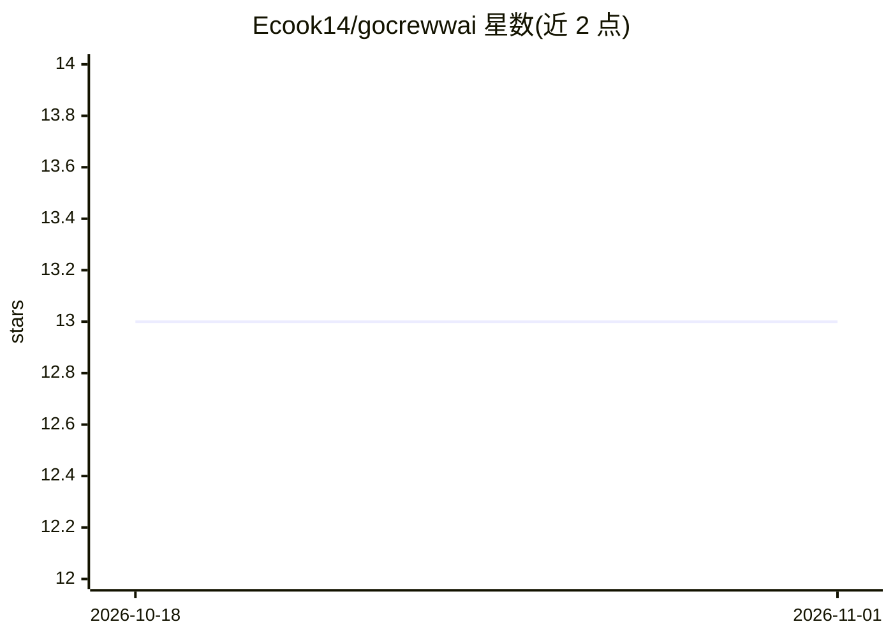

# Ecook14/gocrewwai

⭐ 13 · Go · MIT · 推送 2026-09-30 · [GitHub](https://github.com/Ecook14/gocrewwai) · 个人维护

**Go 语言的强类型多智能体编排框架，含 CLI 与服务端**

面向 Go 开发者的 agentic 编排框架，提供 gocrew-cli（本地开发工具）与 gocrewwai-server（长驻多租户服务）两个独立二进制。核心机制包括：LLM 响应反序列化为强类型 Go 结构体、每节点后持久化检查点的 Durable Flows、Human-in-the-Loop 中断审批、MCP 与 A2A 协议、向量记忆（10 种后端）、OpenTelemetry 追踪、Docker 沙箱与 SSRF 防护。服务端提供 REST/gRPC/SSE 接口、幂等 kickoff 与按 token 划分的租户会话。限制：Linux 二进制因 CGO 动态链接 glibc，不能直接跑在 Alpine；无头 API 仅允许纯计算工具。状态为 v1.0.0-beta.5。

## 筛选速览

| 维度 | 判定 | 备注 |
|---|---|---|
| AI 角色 | `ai-ecosystem` | LLM/agent 周边工具 |
| 许可风险 | `permissive` | MIT |
| 部署形态 | `desktop` | 安装包/桌面程序 |
| 模型依赖 | — | README 未给出锁定关系 |
| 硬件要求 | — | 无带数字的原话,不猜 |
| 安装摩擦 | `low` | 无编译、无系统依赖或容器化 |
| 成熟度 | `idea` | |

## 能力要点

- LLM 响应反序列化为强类型 Go 结构体（无 GIL 的 goroutine 并发）
- Durable Flows：每节点后检查点到 SQLite/Redis，支持暂停/恢复/回溯
- MCP 与 A2A 协议、Human-in-the-Loop 审批门
- 服务端多租户：owner-scoped 会话、Idempotency-Key 幂等、SSE 流式

## 适用场景

- 在 Go 项目中以库形式编排多智能体工作流
- 把编排好的 crew 部署为带认证与多租户的长期服务
- 从 CrewAI/LangChain/LangGraph 项目迁移到 Go 技术栈

## 场景标签

`Agent 框架` `多智能体` · 领域:Agent 开发

## 证据(README 行号)

> L3: Strictly-typed agentic orchestration for Go. Inspired by CrewAI, LangChain, and LangGraph.
> L42: 3. **Memory & State**: Vector-indexed memory (10 backends) with durable flow checkpoints.
> L47: 1. **Durable Flows & Checkpoints** — Pause, resume, and time-travel through long-running

## 星数曲线

2026-10-18 13 → 2026-11-01 13（+0）

---
*卡片 v1 · prompt 1.4 · 生成 2026-10-31 · 置信度 high · 依据 README sha `dbe0a98408a8` · [字段定义](../../DATASET.md)*
