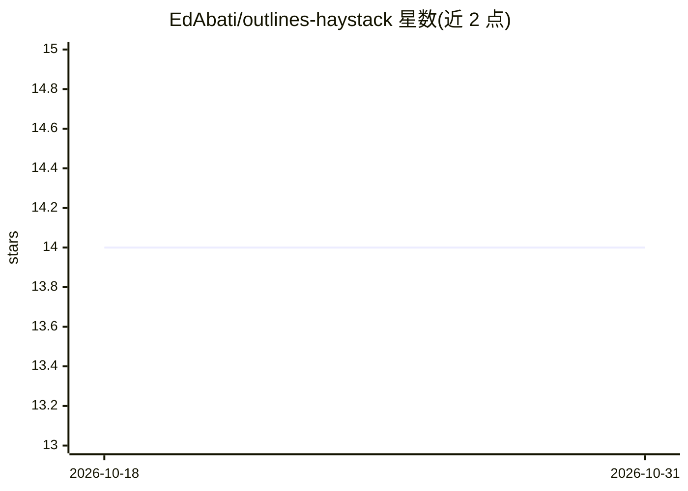

# EdAbati/outlines-haystack

⭐ 14 · Python · MIT · 推送 2026-10-26 · [GitHub](https://github.com/EdAbati/outlines-haystack) · [官网](https://pypi.org/project/outlines-haystack/) · 个人维护

**在 Haystack 管道中使用 outlines 结构化生成器的集成库**

Python 库，将 outlines 的生成器接入 Haystack pipelines，当前支持 JSON（按 schema 生成）、Choices（从选项中生成，可用于分类）与 Text 三类生成器，Regex/Format/Grammar 标注为待支持。生成器支持 OpenAI/Azure OpenAI、Transformers、llama-cpp、mlx-lm 后端。README 提示：纯文本生成建议用 Haystack 内置生成器。面向使用 Haystack 构建 LLM 应用的开发者，pip 安装，MIT 许可。

## 筛选速览

| 维度 | 判定 | 备注 |
|---|---|---|
| AI 角色 | `ai-ecosystem` | LLM/agent 周边工具 |
| 许可风险 | `permissive` | MIT |
| 部署形态 | `library` | 以包/库形式分发 |
| 模型依赖 | locked-api |  |
| 硬件要求 | — | 无带数字的原话,不猜 |
| 安装摩擦 | `low` | 无编译、无系统依赖或容器化 |
| 成熟度 | — | 结构信号不足 |

## 能力要点

- JSON/Choices/Text 三类 outlines 生成器的 Haystack 组件
- 支持 OpenAI/Azure OpenAI、Transformers、llama-cpp、mlx-lm 后端
- 提供示例 Notebook 与 pydantic schema 用法示例

## 适用场景

- 在 Haystack 管道中按 JSON schema 约束 LLM 输出
- 用选项生成器做 LLM 分类任务
- 结合本地 llama-cpp 或 Transformers 模型做结构化生成

## 场景标签

 · 领域:LLM 基础设施/结构化生成

## 证据(README 行号)

> L25: This library allow you to use `outlines` generators in your Haystack pipelines!
> L35: `outlines` supports a wide range of models and frameworks, we are currently supporting:

## 星数曲线

2026-10-18 14 → 2026-10-31 14（+0）

---
*卡片 v1 · prompt 1.4 · 生成 2026-10-31 · 置信度 high · 依据 README sha `d0c0bdf10389` · [字段定义](../../DATASET.md)*
