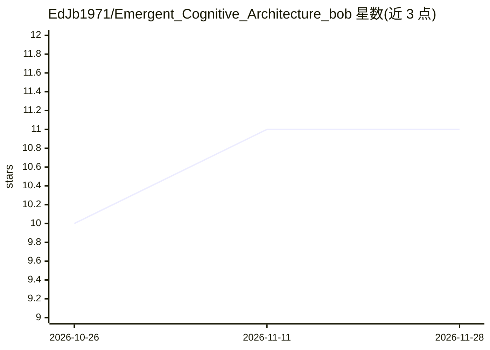

# EdJb1971/Emergent_Cognitive_Architecture_bob

⭐ 11 · Python · AGPL-3.0 · 推送 2026-08-08 · [GitHub](https://github.com/EdJb1971/Emergent_Cognitive_Architecture_bob) · 个人维护

**神经启发多智能体认知架构平台，实现持续学习与记忆**

以脑区类比组织的多智能体系统：基底节式强化学习（策略 Q 值、习惯形成，持久化于 ChromaDB）、前额叶式元认知监控（知识边界与过度自信估计）、小脑类比程序性学习、动态注意控制器、心理理论推断与多模态感官绑定。后端为 Python/FastAPI，前端提供可选 Vite 控制面板，含睡眠巩固调度、自治任务管理与不可变执行账本。面向 AI 研究与交互式系统开发，README 自述状态为 Research。

## 筛选速览

| 维度 | 判定 | 备注 |
|---|---|---|
| AI 角色 | `ai-native` | 本体是模型或模型工具 |
| 许可风险 | `viral` | AGPL-3.0 |
| 部署形态 | `None` |  |
| 模型依赖 | local-ok | 支持本地模型 |
| 硬件要求 | — | 无带数字的原话,不猜 |
| 安装摩擦 | `low` | 无编译、无系统依赖或容器化 |
| 成熟度 | — | 结构信号不足 |

## 能力要点

- 基底节式强化学习：策略 Q 值与习惯持久化于 ChromaDB
- 元认知监控输出回答/搜索/拒答动作决策
- 本地视觉与听觉中继：图像/音频经校验后交由 Ollama 模型处理
- 大量 .env 特性开关控制注意、显著性与睡眠巩固等子系统

## 适用场景

- 研究认知架构与记忆巩固机制的原型实现
- 构建具备跨会话持续记忆的对话系统
- 实验多智能体的动态注意与策略切换

## 场景标签

`多智能体` · 领域:Agent 开发

## 证据(README 行号)

> L5: Neuroscience-inspired multi-agent platform that forms habits, switches strategies mid-conversation, and knows when t
> L23: - **Basal Ganglia–style reinforcement learning**: Strategy Q-values, habit formation, and per-user preferences pers
> L35: |ReinforcementLearningService|Basal Ganglia|Strategy Q-values, habit formation|

## 星数曲线

2026-10-26 10 → 2026-11-28 11（+1）

---
*卡片 v1 · prompt 1.4 · 生成 2026-11-19 · 置信度 mid · 依据 README sha `8b542a2f3b7b` · [字段定义](../../DATASET.md)*
