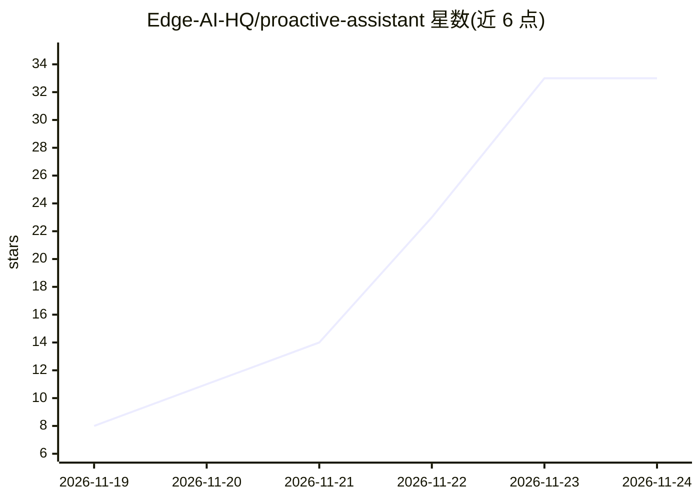

# Edge-AI-HQ/proactive-assistant

⭐ 48 · TypeScript · MIT · 推送 2026-11-16 · [GitHub](https://github.com/Edge-AI-HQ/proactive-assistant) · 组织维护 · 中文 README

**连接你的应用与设备的主动式个人 AI 助手**

开源个人 AI，后台连接用户已有应用与设备，构建长期记忆（原始数据→事件日志→人物画像三层），并在值得注意时主动推送建议卡片。后端为 Python uv 工作区三个互不导入的服务：可信 api 持有主凭据，agent-engine 以短-lived Ed25519 签名令牌访问数据，reward-dashboard 支撑卡片审阅。前端共享 TypeScript 层覆盖 React Web、Electron 桌面与 Expo iOS。副作用操作需用户批准。

## 筛选速览

| 维度 | 判定 | 备注 |
|---|---|---|
| AI 角色 | `ai-native` | 本体是模型或模型工具 |
| 许可风险 | `permissive` | MIT |
| 部署形态 | `None` |  |
| 模型依赖 | — | README 未给出锁定关系 |
| 硬件要求 | — | 无带数字的原话,不猜 |
| 安装摩擦 | `low` | 无编译、无系统依赖或容器化 |
| 成熟度 | — | 结构信号不足 |

## 能力要点

- 生成式 agent 检测变化并主动产出带 why-now 上下文的卡片
- 三层终身记忆由后台 evolve agent 持续整理
- 经 Composio 连接 Gmail/Calendar/Slack/GitHub/Notion 等十余项服务
- agent 运行时不可信设计：不接触主凭据，破坏性操作回交用户

## 适用场景

- 让 AI 在你开口前主动汇总跨应用动态并给出建议
- 通过对话让 agent 检索记忆、浏览网页、运行代码、操作已连接应用
- 自托管搭建 Web/macOS/iOS 三端个人助手

## 场景标签

`AI 助手` `Agent 记忆` · 领域:Agent 开发

## 证据(README 行号)

> L14: PIN AI is an open-source personal AI that works for you in the background. It connects to the apps and devices you 
> L40: - **agent-engine** (`agent_engine`) runs every LLM agent: chat, card generation, memory evolution. It treats its in

## 星数曲线

2026-11-19 8 → 2026-11-24 33（+25）

---
*卡片 v1 · prompt 1.4 · 生成 2026-11-20 · 置信度 high · 依据 README sha `373fdf7840a2` · [字段定义](../../DATASET.md)*
