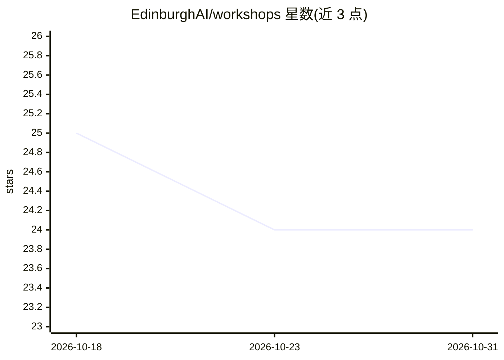

# EdinburghAI/workshops

⭐ 24 · Jupyter Notebook · 推送 2026-10-19 · [GitHub](https://github.com/EdinburghAI/workshops) · [官网](https://www.edinburghai.org) · 组织维护

**面向学生的机器学习实践工作坊 notebook 教学资源库**

Edinburgh AI 在爱丁堡大学运行的入门级 AI 工作坊的配套资源仓库，包含 11 个主题工作坊的 notebook、数据集、辅助代码与解答文件，内容覆盖线性回归、PyTorch 神经网络、CNN、语言模型、YOLO 检测、强化学习、ASL 分类、RAG 播客生成等。主要运行途径是 Kaggle notebook 环境，也可用 Jupyter 本地运行，但本地环境未在所有主题间标准化，Notes to Podcast 需 Linux 系统包与 Ollama 服务。旧版本材料保留在 legacy 目录。

## 筛选速览

| 维度 | 判定 | 备注 |
|---|---|---|
| AI 角色 | `ai-knowledge` | 知识聚合/清单类 |
| 许可风险 | `none` | — |
| 部署形态 | `None` |  |
| 模型依赖 | local-ok | 支持本地模型 |
| 硬件要求 | — | 无带数字的原话,不猜 |
| 安装摩擦 | `low` | 无编译、无系统依赖或容器化 |
| 成熟度 | — | 结构信号不足 |

## 能力要点

- 11 个主题工作坊覆盖回归、CNN、语言模型、目标检测、强化学习等
- 以 Kaggle 为默认共享环境（浏览器 notebook、可选 GPU）
- 每个工作坊目录含专属 README、学生 notebook 与解答文件
- 含无需编程的浏览器应用活动（体育视觉、推荐系统）

## 适用场景

- 参加 Edinburgh AI 工作坊的学生按目录选择并运行对应 notebook
- 自学者按主题（如 YOLO 检测、DQN 强化学习）跟随实践项目
- 教师参考或改编机器学习入门教学材料

## 场景标签

`教程课程` · 领域:学习与行业

## 证据(README 行号)

> L10: Edinburgh AI runs beginner-friendly AI workshops at the University of Edinburgh. This repo contains the notebooks, 
> L12: Each workshop focuses on a concrete build or activity: a regression model, a neural-network classifier, CNN visuali

## 星数曲线

2026-10-18 25 → 2026-10-31 24（-1）

---
*卡片 v1 · prompt 1.4 · 生成 2026-10-27 · 置信度 high · 依据 README sha `a9d2bfb21320` · [字段定义](../../DATASET.md)*
