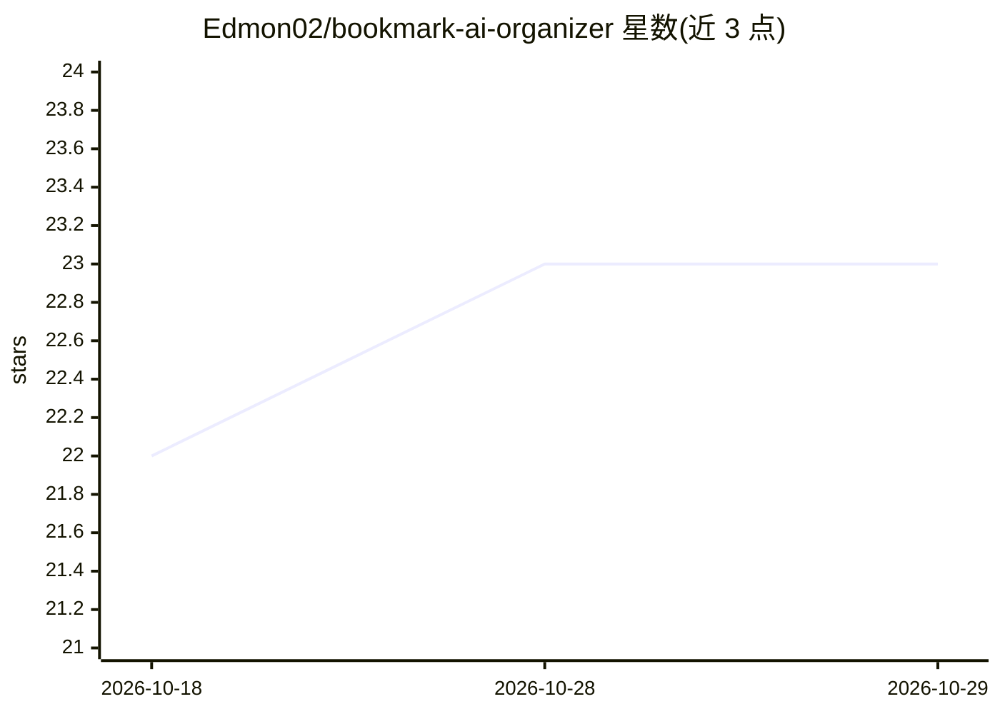

# Edmon02/bookmark-ai-organizer

⭐ 23 · TypeScript · Apache-2.0 · 推送 2026-09-21 · [GitHub](https://github.com/Edmon02/bookmark-ai-organizer) · [官网](https://github.com/Edmon02/bookmark-ai-organizer#readme) · 个人维护

**AI 分类整理浏览器书签的 Chrome 扩展**

Manifest V3 Chrome 扩展：通过用户选择的 LLM 供应商（OpenRouter/OpenAI/Groq/Moonshot/Grok，或自动检测）对书签做一键分类，建议文件夹与标签并给出置信度；支持对已存书签换模型重新分类，以及新书签自动分类。API key 仅存于本地 chrome.storage，运行时消息校验、URL 协议检查、OpenRouter 模型列表带超时重试与过期缓存回退。以源码方式提供：npm install 后 npm run build，在 chrome://extensions 加载 dist 目录使用。

## 筛选速览

| 维度 | 判定 | 备注 |
|---|---|---|
| AI 角色 | `ai-native` | 本体是模型或模型工具 |
| 许可风险 | `permissive` | Apache-2.0 |
| 部署形态 | `library` | 以包/库形式分发 |
| 模型依赖 | locked-api |  |
| 硬件要求 | — | 无带数字的原话,不猜 |
| 安装摩擦 | `low` | 无编译、无系统依赖或容器化 |
| 成熟度 | — | 结构信号不足 |

## 能力要点

- 一键 Classify & Save，输出文件夹、标签、置信度与所用模型
- 支持 OpenRouter/OpenAI/Groq/Moonshot/Grok 及自动检测
- 新书签可选自动分类，已有书签可换模型重新分类
- API key 本地存储，OpenRouter 模型获取含重试与过期缓存回退

## 适用场景

- 清理散乱的书签，自动归入合适文件夹并打标签
- 对分类结果不满意时换模型重新分类
- 新建书签时自动归类，无需手动整理

## 场景标签

 · 领域:浏览器工具/效率

## 证据(README 行号)

> L3: AI-powered Chrome extension that classifies and organizes bookmarks using your preferred LLM provider.
> L16: - One-click `Classify & Save` with folder and tag suggestions.

## 星数曲线

2026-10-18 22 → 2026-10-29 23（+1）

---
*卡片 v1 · prompt 1.4 · 生成 2026-10-28 · 置信度 high · 依据 README sha `3686e47fbd5b` · [字段定义](../../DATASET.md)*
