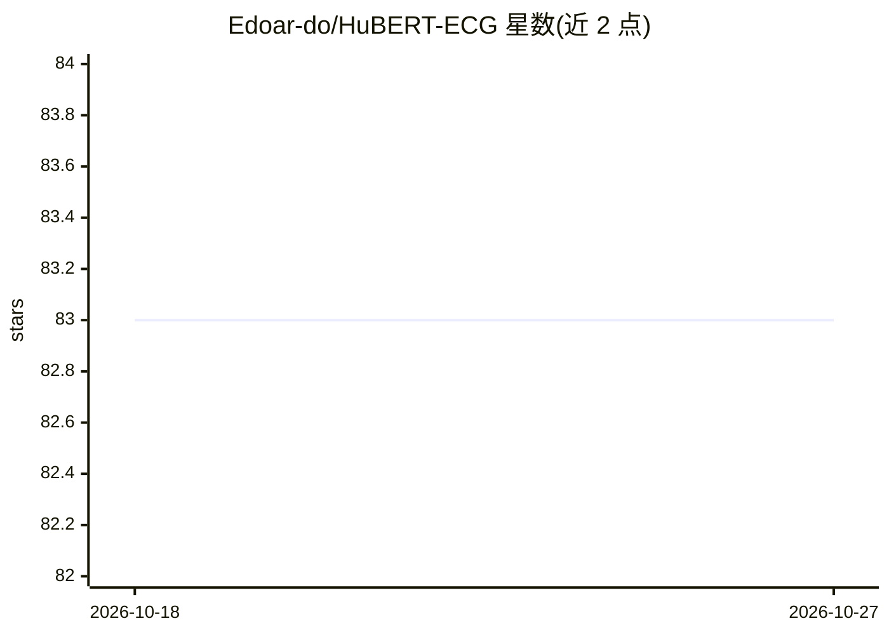

# Edoar-do/HuBERT-ECG

⭐ 83 · Shell · NOASSERTION · 推送 2026-10-04 · [GitHub](https://github.com/Edoar-do/HuBERT-ECG) · 组织维护

**ECG 自监督基础模型：在 910 万份心电数据上预训练并微调**

HuBERT-ECG 是面向心电图的自监督基础模型，基于 4 国 910 万份 12 导联 ECG 预训练，在 21 个独立数据集、1.6k+ 诊断与预后目标上微调评估，提供三种模型规模。以 Python 包形式发布，含 4 个 CLI 入口（预训练/微调/评估/权重转换），模型权重与代码以 CC BY-NC 4.0 在 Hugging Face 开放；支持 Docker 与 memmap 数据集加速 I/O。限制：许可证为非商业（BY-NC）。

## 筛选速览

| 维度 | 判定 | 备注 |
|---|---|---|
| AI 角色 | `ai-native` | 本体是模型或模型工具 |
| 许可风险 | `none` | NOASSERTION |
| 部署形态 | `self-host` | docker 或自建部署 |
| 模型依赖 | — | README 未给出锁定关系 |
| 硬件要求 | — | 无带数字的原话,不猜 |
| 安装摩擦 | `low` | 无编译、无系统依赖或容器化 |
| 成熟度 | — | 结构信号不足 |

## 能力要点

- 910 万份 12 导联 ECG 自监督预训练，三种模型规模
- 在 21 个数据集、1.6k+ 诊断/预后目标上评估，含单导联场景
- 通过 AutoModel API 从 Hugging Face 直接加载权重
- 提供预训练/微调/评估/转换四个 CLI 入口与复现脚本

## 适用场景

- 在自有 ECG 数据集上微调做心律或疾病诊断
- 加载预训练权重做下游预后预测任务
- 复现论文中的训练与评估流程

## 场景标签

`微调` `模型训练` · 领域:训练与推理

## 证据(README 行号)

> L10: The electrocardiogram (ECG) is a widely accessible tool for cardiovascular assessment, and thegrowing availability 
> L16: - [12/2024] Pre-trained models are easily downloadable from Hugging Face 🤗 using `AutoModel` APIs!

## 星数曲线

2026-10-18 83 → 2026-10-27 83（+0）

---
*卡片 v1 · prompt 1.4 · 生成 2026-10-24 · 置信度 high · 依据 README sha `11450296f73d` · [字段定义](../../DATASET.md)*
