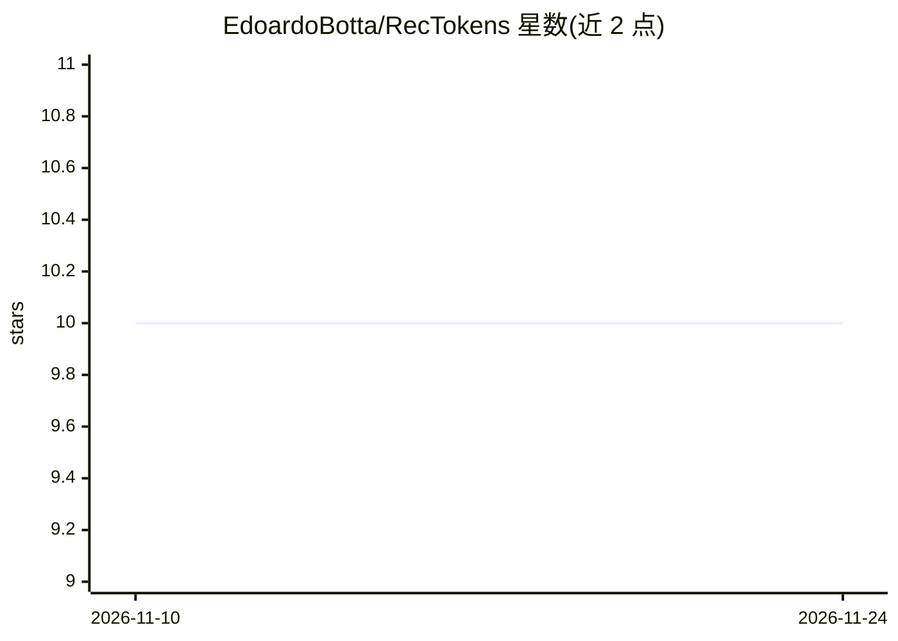

# EdoardoBotta/RecTokens

⭐ 10 · Python · Apache-2.0 · 推送 2026-08-24 · [GitHub](https://github.com/EdoardoBotta/RecTokens) · 个人维护

**面向推荐系统的序列化 item 分词库：把 item 嵌入转为离散 token 供 LLM 微调**

PyTorch 库，用残差量化（RQ）把连续 item 嵌入转成多级离散 token 序列，服务于生成式推荐流水线。提供三部分组件：RQKMeans/RQVAE 两种分词器、GPU 加速的 CSR trie 约束解码（含 Triton 融合核）、以及 HuggingFace 集成（ItemAwareTokenizer、ItemAwareCausalLM、两种 collator），可在预训练 LLM 上以最小样板微调推荐序列。README 给出基于 Amazon Reviews 数据集的端到端工作流与评估脚本。约束解码的 GPU kernel 需 CUDA。

## 筛选速览

| 维度 | 判定 | 备注 |
|---|---|---|
| AI 角色 | `ai-native` | 本体是模型或模型工具 |
| 许可风险 | `permissive` | Apache-2.0 |
| 部署形态 | `library` | 以包/库形式分发 |
| 模型依赖 | — | README 未给出锁定关系 |
| 硬件要求 | — | 无带数字的原话,不猜 |
| 安装摩擦 | `medium` | 含编译或系统依赖之一 |
| 成熟度 | — | 结构信号不足 |

## 能力要点

- RQKMeans（无需 GPU）与 RQVAE 两种残差量化分词器
- CSR 格式 GPU trie 约束解码，含 Triton 融合 kernel（掩码投影与融合采样）
- HuggingFace 集成：item 感知分词器与因果 LM 适配，支持 HF Trainer 微调
- 提供基于 Amazon Reviews 的端到端训练、预处理与检索评估脚本

## 适用场景

- 把推荐场景的 item 目录编码为 token 序列后在 LLM 上微调
- 生成式推荐推理时把生成限制在合法 item 序列内
- 在 Amazon Reviews 等数据集上复现/实验生成式检索方法

## 场景标签

`推荐系统` `微调` · 领域:学习与行业

## 证据(README 行号)

> L7: A tokenizer library for sequential recommendation systems. RecTokens converts continuous item embeddings into discre
> L11: Modern sequential recommendation models treat item retrieval as a language modeling problem: given a user's interac
> L15: 3. **HuggingFace Integration** — Plug item tokens directly into any pretrained LLM from HuggingFace. `ItemAwareToke

## 星数曲线

2026-11-10 10 → 2026-11-24 10（+0）

---
*卡片 v1 · prompt 1.4 · 生成 2026-11-20 · 置信度 high · 依据 README sha `ba12f1071ba2` · [字段定义](../../DATASET.md)*
