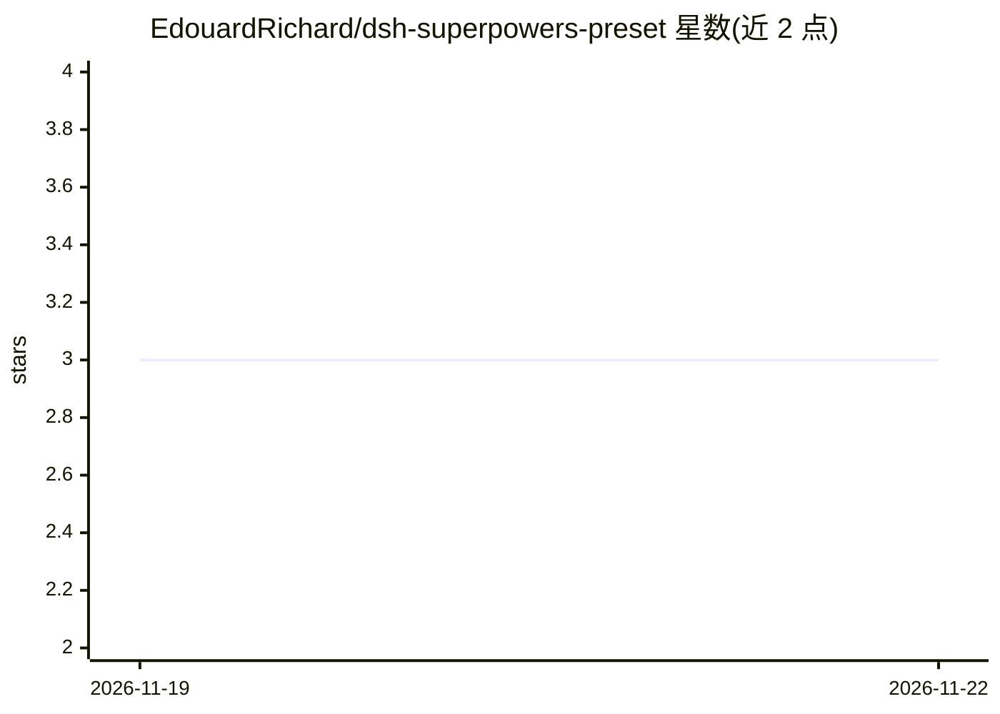

# EdouardRichard/dsh-superpowers-preset

⭐ 3 · JavaScript · MIT · 推送 2026-11-09 · [GitHub](https://github.com/EdouardRichard/dsh-superpowers-preset) · 个人维护 · 中文 README

**把 obra/superpowers 方法论做成 DeepSeek Harness 的可选 Agent 模式**

一个面向 DeepSeek Harness (DSH) 的 npm 包，通过 dsh plugin 通道安装一个 agent-preset 声明，把 obra/superpowers v6.4.2 的 15 个开发技能注册进该预设自己的技能层，工作流约定以 persona 形式进入系统提示词。与插件方式不同，技能目录仅在该模式内可见，不用时不占其他会话的 token。覆盖头脑风暴、写计划、TDD、排障、代码评审等五阶段流程。依赖 DSH 0.2.2-rc.1 验证，运行时无第三方依赖（Node >= 20），第三方预设不显示内置的「模式说明」按钮，需查随包文档。

## 筛选速览

| 维度 | 判定 | 备注 |
|---|---|---|
| AI 角色 | `ai-ecosystem` | LLM/agent 周边工具 |
| 许可风险 | `permissive` | MIT |
| 部署形态 | `desktop` | 安装包/桌面程序 |
| 模型依赖 | locked-api |  |
| 硬件要求 | — | 无带数字的原话,不猜 |
| 安装摩擦 | `low` | 无编译、无系统依赖或容器化 |
| 成熟度 | — | 结构信号不足 |

## 能力要点

- 15 个技能注册进预设自身作用域，不挂载到 host 全局层
- 清单从官方 standard 预设镜像生成，npm run verify 做逐行校验
- 五个阶段开发流程：想清楚→写计划→执行→排障→收尾
- 支持 profile patch 自定义覆盖每一行

## 适用场景

- 在 DSH 里以 Superpowers 模式做功能开发、缺陷修复与重构
- 希望 Agent 先讨论需求和设计再动手写代码
- 通过 /brainstorming、/test-driven-development 等命令点名技能
- 用一次性 profile 端到端验证预设挂载结果

## 场景标签

`提示工程` `编码 Agent` · 领域:Agent 开发

## 证据(README 行号)

> L6: 做成一个 **DeepSeek Harness (DSH) Agent 预设**。
> L27: 这个项目换了一条路：把 Superpowers 做成 **Agent 预设**（也就是 DSH 界面里的
> L216: 一句话：`cordis.patch.yml` 往 profile 的组合里插入**一行** agent-preset

## 星数曲线

2026-11-19 3 → 2026-11-22 3（+0）

---
*卡片 v1 · prompt 1.4 · 生成 2026-11-22 · 置信度 high · 依据 README sha `d19172bec4f8` · [字段定义](../../DATASET.md)*
