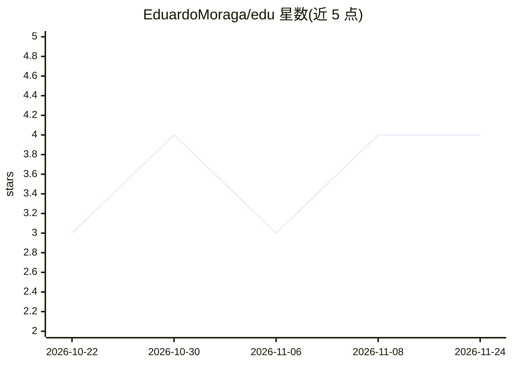

# EduardoMoraga/edu

⭐ — · [GitHub]() · 个人维护

**面向编码 agent CLI 的身份/记忆/编排层：跨 Claude Code 等工具统一协作**

Edu 安装在已有的编码 agent CLI 之内，为 Claude Code、Codex、Pi、OpenCode、Antigravity 提供统一身份、可学习的知识库（brain）与跨 CLI 的 crew 委派机制：从一个 CLI 向另一个派发任务、轮询状态并回收结果。知识导入支持 Word/PDF/Markdown，提取的笔记以提案形式等待人工批准，并带 claim band 标注与 quarantine 机制；编排遵循 playbook → spec 审批 → 检查验证的流程。默认权限为 ask，任务默认 60 分钟超时。安装依赖 Node.js 22+。

## 筛选速览

| 维度 | 判定 | 备注 |
|---|---|---|
| AI 角色 | `ai-ecosystem` | LLM/agent 周边工具 |
| 许可风险 | `permissive` | — |
| 部署形态 | `library` | 以包/库形式分发 |
| 模型依赖 | — | README 未给出锁定关系 |
| 硬件要求 | — | 无带数字的原话,不猜 |
| 安装摩擦 | `low` | 无编译、无系统依赖或容器化 |
| 成熟度 | — | 结构信号不足 |

## 能力要点

- 跨 CLI 派发与回收 crew 任务（dispatch/status/result/cancel）
- edu create 将 Word/PDF/Markdown 转为 Obsidian 工作区，笔记需人工批准
- H0–H3 claim band 与坏笔记隔离的记忆机制
- 只读审查者要求来自不同厂商的 CLI

## 适用场景

- 在 Claude Code 中调用 Codex 为项目写测试并实时查看
- 把团队文档建成可问答、可批准的知识库工作区
- 通过 Telegram 与工作区对话
- 用 playbook 让 agent 团队按自己的流程执行并自动跑检查

## 场景标签

`知识库管理` `Agent 记忆` · 领域:Agent 开发

## 证据(README 行号)

> L10: **Edu lives inside the coding agent you already use.** It gives Claude Code, Codex, Pi,
> L11: OpenCode and Antigravity one identity, a second brain that learns, and a crew: from any of
> L154: Eight workflows, the same everywhere: **brief · recall · remember · reflect · crew · run ·

## 星数曲线

2026-10-22 3 → 2026-11-24 4（+1）

---
*卡片 v1 · prompt 1.4 · 生成 2026-11-21 · 置信度 high · 依据 README sha `fcafc373fc12` · [字段定义](../../DATASET.md)*
