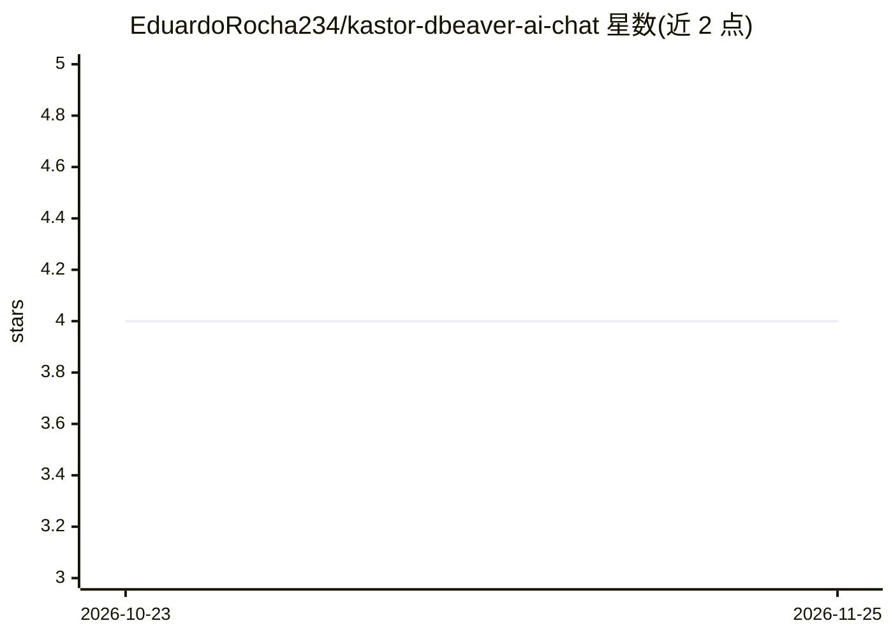

# EduardoRocha234/kastor-dbeaver-ai-chat

⭐ 4 · Java · MIT · 推送 2026-10-14 · [GitHub](https://github.com/EduardoRocha234/kastor-dbeaver-ai-chat) · 个人维护

**DBeaver 内嵌 AI 聊天插件：用自然语言查询和管理数据库**

以 DBeaver（CE 24.1.0+）插件形式安装的 AI 聊天面板，可读取已配置的数据库连接、列出连接/模式/表结构，自主执行只读查询（SELECT/SHOW/EXPLAIN），写操作需用户在聊天中批准，只读连接禁止写入。支持任意 OpenAI 兼容 API 或 Anthropic API，含本地模型；可生成 XLSX/CSV/PDF/DOCX 文件。安全机制包括列值掩码、本地审计日志、dbeaver.ini 团队策略。通过 update site 或离线 zip 安装，MIT 许可。

## 筛选速览

| 维度 | 判定 | 备注 |
|---|---|---|
| AI 角色 | `ai-enhanced` | 去掉 AI 部分产品仍成立 |
| 许可风险 | `permissive` | MIT |
| 部署形态 | `None` |  |
| 模型依赖 | local-ok | 支持本地模型 |
| 硬件要求 | — | 无带数字的原话,不猜 |
| 安装摩擦 | `medium` | 含编译或系统依赖之一 |
| 成熟度 | — | 结构信号不足 |

## 能力要点

- 接入 DBeaver 已配置连接，浏览 schema 与表结构
- 写操作（INSERT/UPDATE/DELETE/DDL）需聊天内批准，只读连接禁止写入
- 列掩码、本地 audit.jsonl 审计、dbeaver.ini 团队级策略
- 自然语言生成 XLSX/CSV/PDF/DOCX 文件，数据不经过 AI 提供商

## 适用场景

- 在 DBeaver 中用自然语言查询数据库并生成报表文件
- 让 AI 读取表结构辅助编写 SQL
- 团队通过配置统一禁用写操作并启用审计

## 场景标签

`聊天机器人` `数据分析` · 领域:效率与自动化

## 证据(README 行号)

> L5: Chat de IA dentro do DBeaver (CE 24.1.0 ou mais novo) com acesso às conexões configuradas.
> L51: - Comandos de escrita (`INSERT`, `UPDATE`, `DELETE`, DDL) **só depois da sua aprovação** no chat.
> L72: **3.** Escolha um **Modelo pronto** (Anthropic, OpenAI, Ollama, LM Studio, OpenRouter) ou **Personalizado**, confir

## 星数曲线

2026-10-23 4 → 2026-11-25 4（+0）

---
*卡片 v1 · prompt 1.4 · 生成 2026-11-21 · 置信度 high · 依据 README sha `fdf0d435d58b` · [字段定义](../../DATASET.md)*
