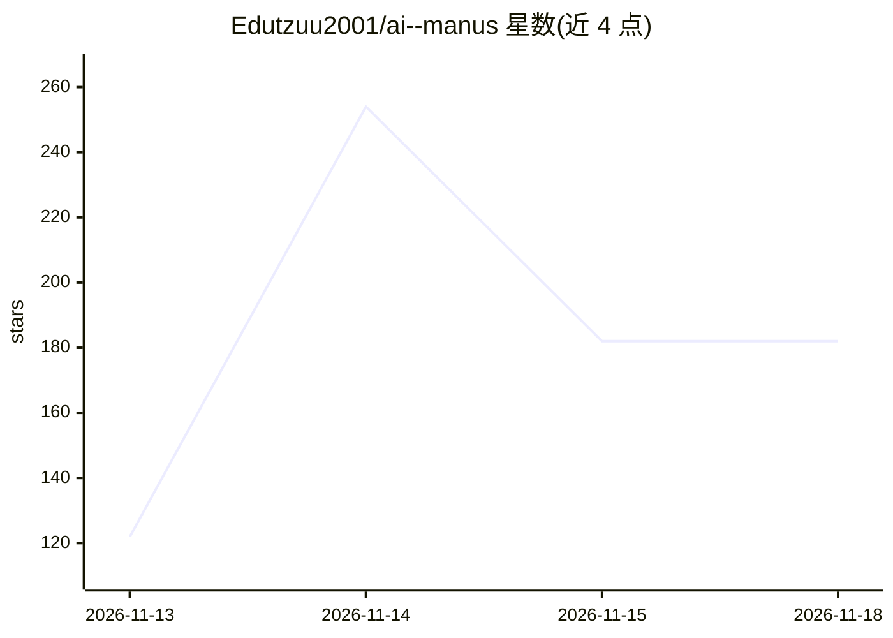

# Edutzuu2001/ai--manus

⭐ 182 · Apache-2.0 · 推送 2026-11-14 · [GitHub](https://github.com/Edutzuu2001/ai--manus) · 个人维护

**面向个人用户的自主 AI Agent，代跑代码并操控浏览器**

README 描述的 Manus 是一个自主运行的 AI agent：用户以指令委托任务，agent 自行编写并执行脚本、控制浏览器完成导航、填表与信息收集，可执行多步骤任务并跨会话复用模式。定位为家庭、学习与轻量办公场景的助手，非企业平台。README 给出 CPU/内存等最低与推荐配置及上手步骤，但未提供代码仓库结构、安装命令或模型接入方式等可验证的技术细节，属于营销式说明文档。

## 筛选速览

| 维度 | 判定 | 备注 |
|---|---|---|
| AI 角色 | `ai-native` | 本体是模型或模型工具 |
| 许可风险 | `permissive` | Apache-2.0 |
| 部署形态 | `None` |  |
| 模型依赖 | — | README 未给出锁定关系 |
| 硬件要求 | — | 无带数字的原话,不猜 |
| 安装摩擦 | `low` | 无编译、无系统依赖或容器化 |
| 成熟度 | — | 结构信号不足 |

## 能力要点

- agent 自主编写并执行脚本完成任务
- 浏览器控制：导航网页、填表、收集信息
- 代码执行与浏览器操作可在同一任务流中衔接
- 面向学习、家庭与轻量办公的小规模场景

## 适用场景

- 让 agent 代为检索网页信息并整理
- 自动执行重复性脚本与文件整理任务
- 远程工作时跨多页面收集数据并汇总

## 场景标签

`浏览器自动化` `编码 Agent` `AI 助手` · 领域:效率与自动化

## 证据(README 行号)

> L18: Manus is an autonomous AI agent designed to run code and control a browser on your behalf. Instead of acting like a
> L10: - **Autonomous Code Execution:** Manus AI agent runs code on its own to complete tasks, so you can focus on decisio

## 星数曲线

2026-11-13 122 → 2026-11-18 182（+60）

---
*卡片 v1 · prompt 1.4 · 生成 2026-11-17 · 置信度 mid · 依据 README sha `8234998f947a` · [字段定义](../../DATASET.md)*
