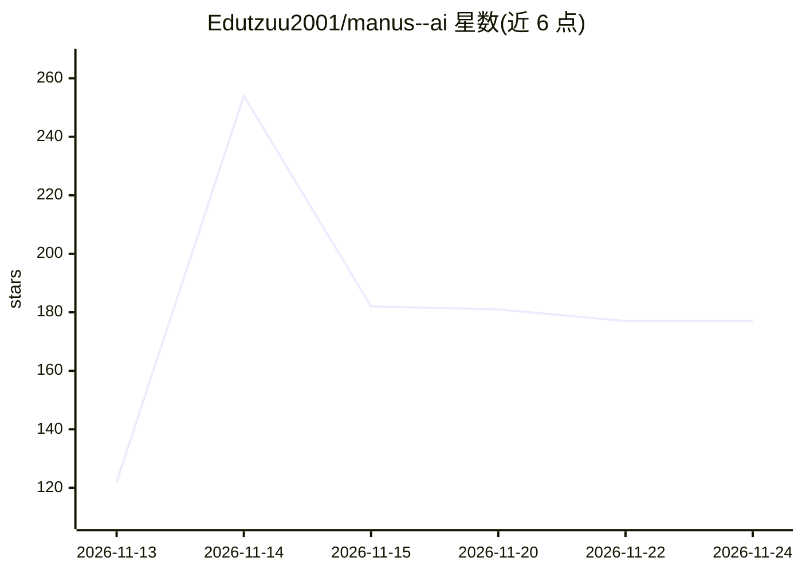

# Edutzuu2001/manus--ai

⭐ 177 · Apache-2.0 · 推送 2026-11-14 · [GitHub](https://github.com/Edutzuu2001/manus--ai) · 个人维护

**面向日常任务的自主 AI Agent：代用户执行代码与控制浏览器**

定位为个人助手型自主 Agent，核心能力是代替用户编写并执行脚本、控制浏览器（导航网页、填表、抓取信息）以及执行多步骤任务，主要面向家庭、学习与轻量办公场景，非企业平台。README 以功能描述为主，说明了 CPU/内存等兼容性要求与上手步骤（配置、测试、维护），但未给出具体的安装命令、模型接入方式或技术实现细节，实际可用性无法从文档验证。

## 筛选速览

| 维度 | 判定 | 备注 |
|---|---|---|
| AI 角色 | `ai-native` | 本体是模型或模型工具 |
| 许可风险 | `permissive` | Apache-2.0 |
| 部署形态 | `None` |  |
| 模型依赖 | — | README 未给出锁定关系 |
| 硬件要求 | — | 无带数字的原话,不猜 |
| 安装摩擦 | `low` | 无编译、无系统依赖或容器化 |
| 成熟度 | — | 结构信号不足 |

## 能力要点

- 自主执行代码与脚本编写/运行
- 浏览器控制：导航、填表、信息抓取
- 多步骤任务可在脚本与浏览器操作之间衔接
- 面向学习、家庭与轻量办公的小型任务场景

## 适用场景

- 让学生整理研究笔记、跑快速计算
- 让 agent 代为浏览多个网页汇总信息
- 把重复性小任务委托给后台 agent 处理

## 场景标签

`AI 助手` `浏览器自动化` `编码 Agent` · 领域:效率与自动化

## 证据(README 行号)

> L18: Manus is an autonomous AI agent designed to run code and control a browser on your behalf. Instead of acting like a

## 星数曲线

2026-11-13 122 → 2026-11-24 177（+55）

---
*卡片 v1 · prompt 1.4 · 生成 2026-11-17 · 置信度 mid · 依据 README sha `8234998f947a` · [字段定义](../../DATASET.md)*
