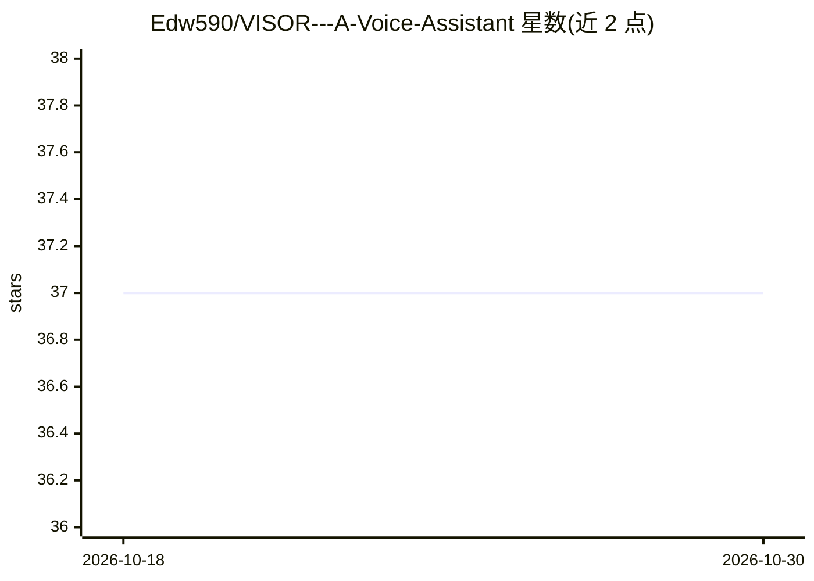

# Edw590/VISOR---A-Voice-Assistant

⭐ 37 · Go · Apache-2.0 · 推送 2025-11-20 · [GitHub](https://github.com/Edw590/VISOR---A-Voice-Assistant) · 个人维护

**Go 编写的桌面语音助手，接本地 LLM 与模块化常驻服务**

个人开发的客户端/服务器架构语音助手 V.I.S.O.R.：服务器（作者跑在 Raspberry Pi 上 24/7）承载 RSS 通知、邮件发送、磁盘 S.M.A.R.T. 检测、本地 LLM 对话等模块；客户端负责语音播报、语音唤醒识别（当前仅识别 Hey VISOR）、用户定位与命令执行。LLM 部分通过 llama.cpp 的 llama-cli 加载 GGUF 模型（如 Llama3.1/3.2）。各模块依赖 curl、chromedriver、festival 等外部程序。支持 Unix-like 与 Windows，从 Release 或源码编译安装。

## 筛选速览

| 维度 | 判定 | 备注 |
|---|---|---|
| AI 角色 | `ai-native` | 本体是模型或模型工具 |
| 许可风险 | `permissive` | Apache-2.0 |
| 部署形态 | `None` |  |
| 模型依赖 | local-ok | 支持本地模型 |
| 硬件要求 | — | 无带数字的原话,不猜 |
| 安装摩擦 | `low` | 无编译、无系统依赖或容器化 |
| 成熟度 | `idea` | |

## 能力要点

- 客户端/服务器分离，服务器 24/7 运行 14 类功能模块
- GPT Communicator 模块经 llama.cpp 运行本地 GGUF 模型（Llama3.1/3.2）
- 语音播报、唤醒词识别与自然语言命令执行
- RSS 监控（YouTube 频道/播放列表、StackExchange）、邮件发送、S.M.A.R.T. 检测

## 适用场景

- 在 Raspberry Pi 上部署常驻服务器，配合桌面客户端做个人语音助手
- 让助手读取本地 LLM 完成对话交互
- 自动监控 RSS/新闻并通过邮件推送通知

## 场景标签

`语音 Agent` `AI 助手` · 领域:对话与助手

## 证据(README 行号)

> L59: | 7 | **GPT Communicator** | Server (Linux only) | Sends and receives text to and from a local LLM (Large Language 
> L63: | 11 | **Speech Recognition** | Client (Windows only) | Currently only checks if the phrase "Hey VISOR" is spoken a

## 星数曲线

2026-10-18 37 → 2026-10-30 37（+0）

---
*卡片 v1 · prompt 1.4 · 生成 2026-10-25 · 置信度 high · 依据 README sha `777b3cbfebc8` · [字段定义](../../DATASET.md)*
