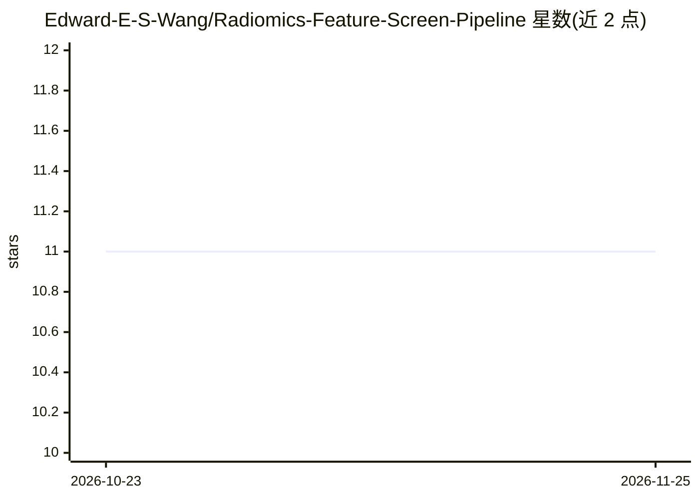

# Edward-E-S-Wang/Radiomics-Feature-Screen-Pipeline

⭐ 11 · Python · 推送 2026-03-10 · [GitHub](https://github.com/Edward-E-S-Wang/Radiomics-Feature-Screen-Pipeline) · 个人维护 · 中文 README

**面向医学影像研究的放射组学特征三阶段筛选流水线**

针对二分类任务的结构化放射组学特征筛选脚本：按 Missing 值处理 → Mann–Whitney U 单变量过滤（p<0.05）→ Spearman 相关去冗余（|ρ|>0.90）→ 自实现 mRMR（支持 MID/MIQ 准则、默认保留 TOP_K=50 个特征）的四步流程逐步降维，输出 11 个 CSV/TXT 中间与最终结果文件。输入要求 CSV（ID、二分类标签、特征列），列索引与阈值参数可在脚本内配置。不依赖 pymrmr，限二分类标签。

## 筛选速览

| 维度 | 判定 | 备注 |
|---|---|---|
| AI 角色 | `ai-native` | 本体是模型或模型工具 |
| 许可风险 | `none` | — |
| 部署形态 | `None` |  |
| 模型依赖 | — | README 未给出锁定关系 |
| 硬件要求 | — | 无带数字的原话,不猜 |
| 安装摩擦 | `low` | 无编译、无系统依赖或容器化 |
| 成熟度 | — | 结构信号不足 |

## 能力要点

- Mann–Whitney U + Spearman + mRMR 三阶段特征筛选工作流
- 自包含 mRMR 实现（分位数离散化、互信息计算、贪心前向选择），不依赖 pymrmr
- 输出 11 个文件，含每阶段特征数汇总与 mRMR 逐步选择记录
- 阈值与列索引参数（p、|ρ|、TOP_K、MID/MIQ、N_BINS）可配置

## 适用场景

- 为放射组学诊断或预后预测模型筛选特征
- 机器学习建模前对高维表格数据做特征降维
- 二分类任务中去除冗余相关特征并记录筛选过程

## 场景标签

 · 领域:医学影像/放射组学分析

## 证据(README 行号)

> L2: A complete radiomics feature selection pipeline for binary classification tasks, integrating **Mann–Whitney U test**
> L19: 1. **Mann–Whitney U test** for preliminary univariate filtering,
> L21: 3. **mRMR** for final multivariate feature ranking and selection.
> L354: ## Recommended Use Cases

## 星数曲线

2026-10-23 11 → 2026-11-25 11（+0）

---
*卡片 v1 · prompt 1.4 · 生成 2026-11-19 · 置信度 mid · 依据 README sha `6e75cc3cb433` · [字段定义](../../DATASET.md)*
