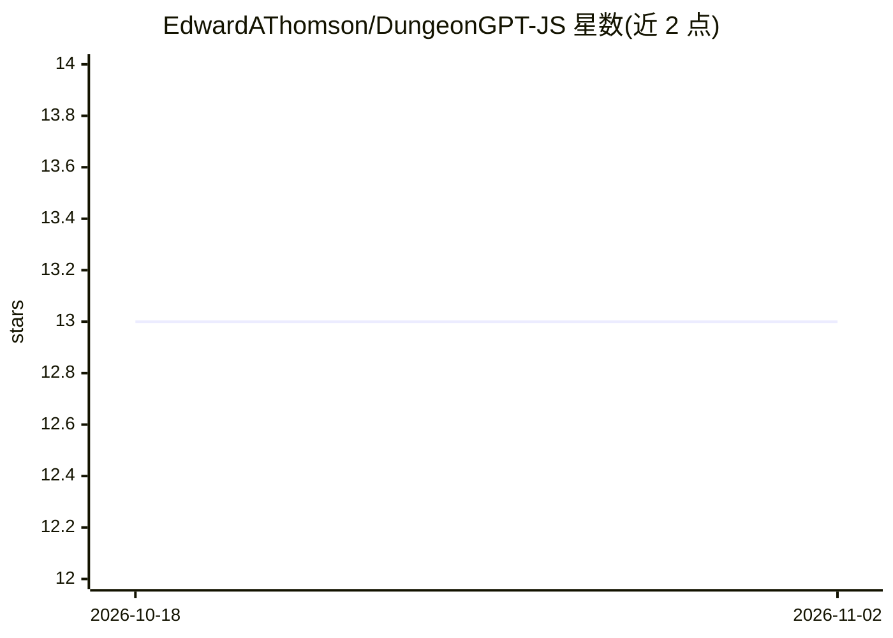

# EdwardAThomson/DungeonGPT-JS

⭐ 13 · JavaScript · Apache-2.0 · 推送 2026-10-15 · [GitHub](https://github.com/EdwardAThomson/DungeonGPT-JS) · [官网](https://dungeongpt.xyz/) · 个人维护

**带 LLM 地下城主的角色扮演网页游戏**

React 网页应用：玩家创建并管理角色（属性、职业、背景），组队进入程序化生成的世界（生物群系、城镇、地牢子地图），进行文本冒险。AI 充当地下城主负责叙述与剧情回忆（基于嵌入式历史的设备端 RAG），但规则判定（d20 掷骰、任务里程碑）由引擎确定性执行，AI 仅叙述不裁决。生产环境运行于 Cloudflare Workers AI（4 模型），本地开发支持 OpenAI/Gemini/Claude，会员经 OpenRouter 获高级模型池。提供游客本地优先游玩与云端同步，数据存自托管 PostgreSQL（本地开发用 SQLite）。

## 筛选速览

| 维度 | 判定 | 备注 |
|---|---|---|
| AI 角色 | `ai-native` | 本体是模型或模型工具 |
| 许可风险 | `permissive` | Apache-2.0 |
| 部署形态 | `library` | 以包/库形式分发 |
| 模型依赖 | locked-api |  |
| 硬件要求 | — | 无带数字的原话,不猜 |
| 安装摩擦 | `low` | 无编译、无系统依赖或容器化 |
| 成熟度 | — | 结构信号不足 |

## 能力要点

- AI 地下城主叙述剧情，规则判定由引擎确定性执行（AI 不裁决）
- 基于嵌入式历史的设备端 RAG 对话记忆
- 程序化生成的世界地图、城镇与可探索子地图
- 生产用 Cloudflare Workers AI，本地开发支持 OpenAI/Gemini/Claude，会员另配 OpenRouter 高级模型池

## 适用场景

- 玩由 AI 主持叙事的文字冒险 RPG
- 创建和管理多个角色并组队冒险
- 无需账号先在浏览器本地试玩，登录后云同步存档

## 场景标签

 · 领域:游戏/互动娱乐

## 证据(README 行号)

> L5: This is a web application built with React that allows users to create detailed characters for role-playing games, m
> L23: * **AI-Powered Game:** Engage in an interactive text-based adventure where the AI acts as the game master, respondi

## 星数曲线

2026-10-18 13 → 2026-11-02 13（+0）

---
*卡片 v1 · prompt 1.4 · 生成 2026-10-31 · 置信度 high · 依据 README sha `7940ba0be375` · [字段定义](../../DATASET.md)*
