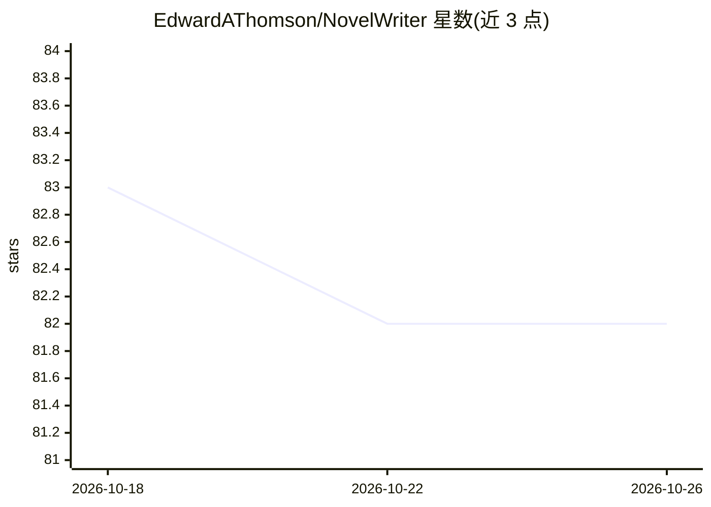

# EdwardAThomson/NovelWriter

⭐ 82 · Python · 推送 2026-10-10 · [GitHub](https://github.com/EdwardAThomson/NovelWriter) · 个人维护

**辅助作者用 LLM 创作小说/短篇的桌面应用**

基于 Tkinter 的 Python GUI 应用，面向小说作者，覆盖参数设定、世界观设定生成、故事结构、场景规划到章节正文写作的完整流程，支持 8 大类型及其子类型的题材化生成。内置 agentic 框架实现多 agent 编排（编排、一致性、质量控制 agent）与多级评审，提供统一多后端 LLM 接口，可在 OpenAI/Claude/Gemini/OpenRouter 等 API 与本地 CLI 工具（codex/gemini/claude）之间路由。需 Python 3.12+，API 密钥存于 .env，从源码运行。

## 筛选速览

| 维度 | 判定 | 备注 |
|---|---|---|
| AI 角色 | `ai-native` | 本体是模型或模型工具 |
| 许可风险 | `none` | — |
| 部署形态 | `library` | 以包/库形式分发 |
| 模型依赖 | locked-api |  |
| 硬件要求 | — | 无带数字的原话,不猜 |
| 安装摩擦 | `low` | 无编译、无系统依赖或容器化 |
| 成熟度 | — | 结构信号不足 |

## 能力要点

- 从参数、世界观到章节正文的完整 GUI 生成流程
- 多 agent 编排（故事编排/一致性/质量控制 agent）与多级评审系统
- 统一多后端 LLM 接口：API 后端与本地 CLI 工具（codex/gemini/claude）可选
- 8 大类型（科幻/奇幻/历史/恐怖/推理/爱情/惊悚/西部）题材化世界构建

## 适用场景

- 我用它从头生成一部完整的长篇小说
- 我按题材生成派系、角色与世界观设定
- 我用 agentic 工作流全自动写出带质量控制的章节

## 场景标签

`AI 写作` · 领域:内容生成

## 证据(README 行号)

> L7: NovelWriter is a comprehensive Python application designed to assist authors in writing novels and short stories acr
> L70: - **Agentic Framework**: True agentic behavior with multi-agent orchestration and tool selection

## 星数曲线

2026-10-18 83 → 2026-10-26 82（-1）

---
*卡片 v1 · prompt 1.4 · 生成 2026-10-24 · 置信度 high · 依据 README sha `722fa7f79b3a` · [字段定义](../../DATASET.md)*
